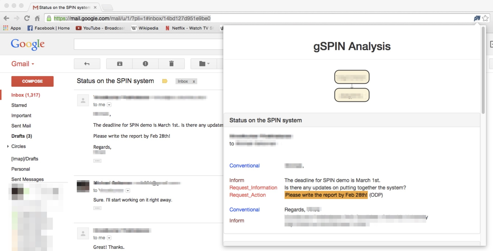

[&larr; Back to Datasets](../index.qmd)

## Midterm Vignette

As mentioned in class during Week 7, this dataset was actually the first dataset brainstormed among the instructors for pre-approved Midterm $\rightarrow$ Final Project purposes! We mention this here because, it represents a rare instance where we can actually analyze **real** data from a real company's backend DB, rather than having to *simulate* it (as in the [healthcare example](../healthcare/index.qmd)).

The most widely-studied version of this dataset contains about [**500,000 emails**](https://www.cs.cmu.edu/~enron/), released to the public as part of the litigation over Enron's prosecution for accounting fraud by the US [Federal Bureau of Investigation](https://www.fbi.gov/history/cases-and-criminals/enron) and Federal Energy Regulatory Commission.

As mentioned on the main [datasets page](../index.qmd), however, the goal here is **not** to analyze the Enron emails as such, but to imagine **how you would handle *new* email data continuously streaming into an OLTP database** with the same structure! In other words, your analysis of this data should be *generalizable* to other organizations with significantly fewer (or significantly more) employees.

Your task here takes inspiration from a [2015 analysis of the Enron corpus](hhttps://www.cs.columbia.edu/~vinod/thesis/SocialPowerInInteractions_PhDThesis_VinodkumarPrabhakaran.pdf) which discovered a set of NLP-based features that could be extracted from the text of the emails which, in turn, predicted with high accuracy both the **gender** and the **level in an organizational chart** of the email-writers. Even within a single 3-email thread, for example, features of language usage already start to emerge, as shown in @fig-gspin. These individual-thread inferences can then be aggregated over the hundreds of thousands of available emails to obtain detailed information about the communicative "culture" within an organization.

{#fig-gspin .lightbox fig-align="center"}

You have been hired as a data scientist at an organization (which was impressed by your big data and cloud computing skills!) which has recently recived concerning reports from HR about an overall **"toxic culture"** when it comes to day-to-day interactions between genders and between higher- and lower-level employees. The organization has heard about how Google's ["Project Oxygen"](https://rework.withgoogle.com/intl/en/guides/following-the-data-the-research-behind-great-managers) reduced tensions between managers and employees, and is hoping you can use their email corpus to identify issues and achieve a similar outcome.

As you can read in @prabhakaran_social_2015, there are straightforward NLP-based features that can be extracted at the **end** of the data-processing pipeline, measuring aspects of the emails like politeness or gendered adjectives ("bossy" vs. "confident"). Your job here is thus to tackle the **infrastructural challenges** that lay *"along the way"* to these measurable outcomes:

* First, the organization would like a well-organized [but internal!] interface like [enron-mail.com](http://www.enron-mail.com/) where they can browse individual emails which may be of concern
* The organization would also like this interface to have a feature where one can click on an individual's name, or the name of a department, to see a "profile" of the extracted NLP features for that individual or department
* Finally, the organization would like a **live dashboard** where they can see essentially a "heatmap" of their different departments, based on the *volume* of emails being sent between members of each department over the past 24 hours.

### Question 1 Starter: OLTP Structure

Here, the OLTP structure used by the organization to record email information is similar to the **logs** of any other [**SMTP email server**](https://en.wikipedia.org/wiki/Simple_Mail_Transfer_Protocol): Sort of like the examples of HTTP and Linux logs we saw in class during Week 1, each **event** or record represents information about an incoming or outgoing email. The following records illustrate the types of issues which may arise in bringing these records from "raw" OLTP form into an OLAP infrastructure.

First, this email (randomly sampled from the folder containing [Kenneth Lay's](https://en.wikipedia.org/wiki/Kenneth_Lay) inbox) illustrates a "well-formatted" email, where fields like `Date`, `Subject`, `From`, and `To`, as well as the plaintext email body, would be easy to parse and enter into an OLAP framework (such as a data warehouse or data lake):

``` {.md filename="lay-k/inbox/28.txt"}
Message-ID: <6755745.1075845190138.JavaMail.evans@thyme>
Date: Thu, 24 May 2001 19:05:02 -0700 (PDT)
From: jhduncan@aol.com
To: klay@enron.com
Subject: The coming trip on May 29th
Mime-Version: 1.0
Content-Type: text/plain; charset=us-ascii
Content-Transfer-Encoding: 7bit
X-From: JHDUNCAN@aol.com@ENRON <IMCEANOTES-JHDUNCAN+40aol+2Ecom+40ENRON@ENRON.com>
X-To: klay@enron.com
X-cc: 
X-bcc: 
X-Folder: \Lay, Kenneth\Lay, Kenneth\Inbox
X-Origin: LAY-K
X-FileName: Lay, Kenneth.pst

Ken, 
With your permission, Harry and I will plan to bring our golf clubs on the  
airplane on Tuesday.  I plan to buy one of those little traveling golf bags  
(very small) and carry only about 5 or 6 of my clubs with me. Mick may or may  
not do the same.  It's your call if this is OK for the plane and whether or  
not you bring yours.  This way when Harry and I get to betting on the game,  
we will not have the quality of the rent clubs as an excuse for the quality  
of our game. 
John
```

However, this email from the same inbox shows that the body of the email may not be so easy to parse, as the Unix operating system running Enron's email server condensed certain emails by line-breaking the text with `=` characters:

``` {.md filename="lay-k/inbox/1810.txt"}
Message-ID: <28698423.1075862888104.JavaMail.evans@thyme>
Date: Tue, 13 Nov 2001 11:38:01 -0800 (PST)
From: w..pereira@enron.com
To: kenneth.lay@enron.com
Subject: ENRON - A Study in How So Few Could Screw So Many
Mime-Version: 1.0
Content-Type: text/plain; charset=us-ascii
Content-Transfer-Encoding: quoted-printable
X-From: Pereira, Susan W. </O=ENRON/OU=NA/CN=RECIPIENTS/CN=SPEREIR>
X-To: Lay, Kenneth </O=ENRON/OU=NA/CN=RECIPIENTS/CN=Klay>
X-cc: 
X-bcc: 
X-Folder: \KLAY (Non-Privileged)\Lay, Kenneth\Inbox
X-Origin: Lay-K
X-FileName: KLAY (Non-Privileged).pst

Mr. Lay-

After reading the news of your $60,000,000 to $80,000,000 payout, I am disg=
usted and appalled all over again.  Unfortunately, that's a daily occurrenc=
e.=20

I have been employed with Enron since May of 1993, when Enron purchased LRC=
.  I was very skeptical of Enron back then and was unsure of my future with=
 the company.  As time went on, I got more comfortable with the Enron way a=
nd learned how to survive and even be a little successful here.  I became a=
 believer in the things Enron could accomplish, a champion of our hard-nose=
d, driven executives (at least some of them).  I bought Enron stock and hel=
d on to those valuable options.

It is painfully obvious to me and my coworkers, as well as the rest of the =
industry and Houston, that Enron's executives knew that there were skeleton=
s in the closet and began cashing in ahead of this freefall.  The employees=
 and the rest of the world were fed a bunch of half-truths and mystery mumb=
o-jumbo.  There should be an accounting for this behavior.  You and your co=
horts have ruined so many lives.  Think about that while you're spending yo=
ur millions.....


Susan Pereira
ENA Gas Trader
```

A second challenge is that, while this is the smallest email in Lay's inbox by filesize, it turns out to be that small because it just references an **attachment** (`pressrelease.doc`) that your OLTP $\leadsto$ OLAP pipeline would need to handle:

``` {.md filename="lay-k/inbox/348.txt"}
Message-ID: <13397155.1075852806479.JavaMail.evans@thyme>
Date: Fri, 19 Oct 2001 09:56:04 -0700 (PDT)
From: abalaban@aei.org
Subject: NAI National Survey Finds Strong Support for Israel
Mime-Version: 1.0
Content-Type: text/plain; charset=us-ascii
Content-Transfer-Encoding: 7bit
X-From: "Alanna Balaban" <abalaban@aei.org>@ENRON
X-To: undisclosed-recipients:;@ENRON
X-cc: 
X-bcc: 
X-Folder: \KLAY (Non-Privileged)\Inbox
X-Origin: Lay-K
X-FileName: KLAY (Non-Privileged).pst

 - pressrelease.doc 
```

As a final example, this email sampled from a different employee's inbox shows how the email addresses in the `.txt` files are not always well-formed – here, the first entry in the `To` field is `e-mail <.arm@enron.com>`, followed by the actual employee email (`jeff.dasovich@enron.com`):

``` {.md filename="dasovich-j/inbox/898.txt"}
Message-ID: <7208739.1075859209244.JavaMail.evans@thyme>
Date: Tue, 20 Nov 2001 09:14:49 -0800 (PST)
From: aaron.thomas@aesmail.com
To: e-mail <.arm@enron.com>, jeff.dasovich@enron.com
Subject: FW: IMPORTANT ! !
Mime-Version: 1.0
Content-Type: text/plain; charset=us-ascii
Content-Transfer-Encoding: quoted-printable
X-From: Aaron Thomas <aaron.thomas@aesmail.com>
X-To: Arm (E-mail) <arm@electric.com>, Dasovich, Jeff </O=ENRON/OU=NA/CN=RECIPIENTS/CN=JDASOVIC>
X-cc: 
X-bcc: 
X-Folder: \Jeff_Dasovich_Jan2002\Dasovich, Jeff\Inbox
X-Origin: Dasovich-J
X-FileName: jdasovic (Non-Privileged).pst

How do folks feel about a call on this subject today.  Say around 2 PM Paci=
fic.
=20
If this works for folks, lets use my dial-in number
=20
888.621.9536
PC *3957889*
=20
Aaron
=20
=20
```

As part of handling these email records, the following **metadata file** collects the names of each "Person of Interest" (POI) during the fraud hearings, including the **list** of emails found in the corpus for each POI:

```{python}
import polars as pl
import itables

enron_meta_pl = pl.read_parquet('enron_meta.parquet')
itables.show(enron_meta_pl)
```

Note that, although it is not the most **efficient** way to store the person-to-email mappings, the Parquet format *does* support typed `List`s, as we can see by calling Polars' `read_parquet_schema()` function on the metadata file displayed above:

```{python}
import polars as pl

pl.read_parquet_schema('enron_meta.parquet')
```
