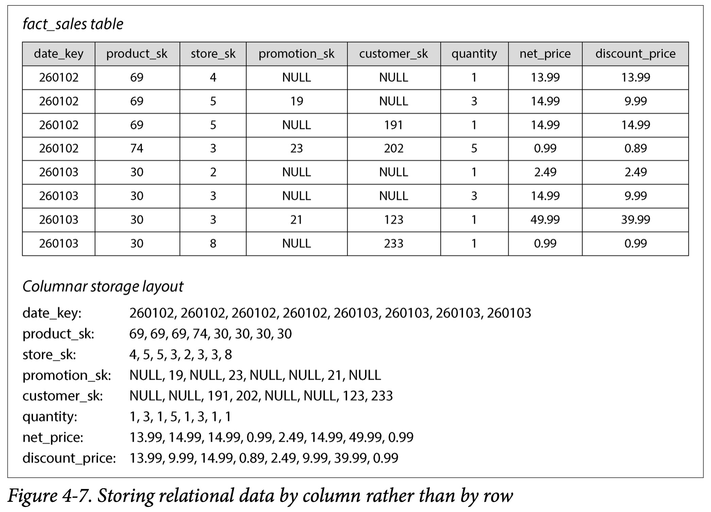

The **in-class midterm** will be held on the following days, based on your section:

* **Section 01:** Monday, November 2, 2026
* **Section 02:** Thursday, November 5, 2026

The purpose of the midterm is twofold:

* First, to assess your comprehension of the course topics from Weeks 1 through 8, and their interrelationships, as they relate to the goals of modern data-driven organizations
* Second, to perform this assessment not in the abstract but via the development of a **concrete plan** that will then serve as a key step in your Final Project!

Your first step, in preparing for the midterm, is to **read through the [dataset vignettes](./final-project/index.qmd)** and decide which one is most interesting to you. Once you have decided, **register your decision on [Canvas](https://georgetown.instructure.com/courses/234516)** by choosing an option within the "Midterm Dataset Choice" assignment.

Finally, you can think through how the following "pieces" of what we've learned up to this point in the course would work relative to your chosen dataset!

## Question 1: OLTP Infrastructure

This question is **started for you** in the vignette for your chosen dataset, where (in the subsection with header "OLTP Structure") you can get a sense for the **existing OLTP infrastructure** at the organization you've been hired at. In each case, your job is to think through **transforming** the information in this OLTP setup into the kinds of insights/inferences described at the beginning of the vignette.

## Question 2: Ingesting, Transforming, and Loading OLTP Snapshots

### Sample Question (NYC Shelter Data)

Although events are entered into the OLTP DB "on the fly" in this case, one issue is that receptionists are asked to *double-check* the daily entries towards the end of their shifts, for things like data entry errors.

Given this information, which of the following OLTP-to-OLAP ingestion plans would make best use of the available information without affecting the OLTP system's ability to store frequently-entered records? Think especially in terms of scalability: will the plan still satisfy these criteria if NYC decides to open up many more shelters in the near future? *(Circle **all** answers that would satisfy these goals)*

(a) Run analytic queries (in DuckDB, Polars, and/or Spark) **directly on the OLTP database**, so that the results of these queries always reflect the most up-to-date data available
(b) Take *"snapshots"* of the OLTP records at the very end of each desk worker's shift, and "dump" each of these snapshots into an **S3 bucket**. Then allow data analysts to run analytic queries on the collection of snapshots in this bucket (e.g., using Athena)
(c) Take *"snapshots"* of the OLTP records at the very end of each desk worker's shift, then use an SQL query to store the records contained in each snapshot into a centralized **fact table** with a pre-determined schema. Then allow data analysts to run analytic queries on this centralized fact table
(d) Every time a desk worker enters a record, immediately store the information from the record (e.g., in `.json` format) as a single file within an **S3 bucket**. Then allow data analysts to run analytic queries on the individual files in the S3 bucket using, e.g., Athena
(e) Every time a desk worker enters a record, immediately execute an SQL query to store the information from the record as a new row within a centralized **fact table** with a pre-determined schema. Then allow data analysts to run analytic queries on this centralized fact table.

The two answers you would want to circle here are **(b)** and **(c)**: You can worry about the differential benefits and drawbacks of data **warehouses** vs. data **lakes** in Question 3, but for this question, the key would be to take the snapshots at the end of the shifts so that the **extraction** of the OLTP records doesn't interfere with the actual **operation** of the OLTP system itself!

Option (a) violates this principle, since (as the Boar Book puts it):

> Database administrators closely guard their OLTP databases. They are usually reluctant to let business analysts run ad hoc analytic queries on an OLTP database, since those queries are often expensive, scanning large parts of the dataset, which can harm the performance of concurrently executing transactions.

Options (d) and (e), on the other hand, are worse than options (b) and (c) just because they "clash" with the **columnar** data-storage approach that we typically desire for OLAP infrastructures: to understand this, think of the discussion in Weeks 2-4 about how writing **individual rows** into a **columnar** format like a `.parquet` file or a DuckDB table is extremely computationally expensive: it requires "hopping" around the file many times. Thus, one of the primary benefits of taking **"snapshots"** of the OLTP DB is so that we capture many records at a time, and thus can add many values to the end of a given column before having to "hop" to the next column.

## Question 3: OLAP Infrastructure

### Sample Question (Enron Email Corpus)

As you can see from the example emails in the [vignette](./final-project/enron/index.qmd), both the content of the emails themselves and their metadata vary wildly in terms of what might be streaming into the OLTP DB (which is just recording the raw text+metadata for every incoming and outgoing email): for example, sometimes the content of the email is included as simple, human-readable plaintext, but sometimes the email body essentially just "points to" a set of attached files. Given this variability, and given how frequently emails are streaming in at this 10,000+ employee organization, which of the following conclusions would you draw for a "best-fit" OLAP infrastructure? *(Choose one)*

(a) A Data Lake infrastructure where all raw data from each email is "dumped" into an S3 bucket (for downstream schema-on-read parsing) makes most sense, since the bandwidth required to write the emails into an S3 bucket would be significantly lower than the bandwidth required to write data from the emails into a warehouse DB table.
(b) A Data Lake infrastructure where all raw data from each email is "dumped" into an S3 bucket (for downstream schema-on-read parsing) makes most sense, since it's difficult to plan in advance what specific "pieces" of the emails might be relevant.
(c) A Data Warehouse infrastructure where email data is written into a table with a pre-defined schema makes most sense, since we can determine in advance what data we want to record and pre-allocate columns within the warehouse DB accordingly
(d) A Data Warehouse infrastructure where email data is written into a table with a pre-defined schema makes most sense, since we can just allocate a "misc_data" column (of raw binary type) to hold any data from the emails that may not fit within the pre-defined schema

Here the answer would be (b), since it's the better choice of infrastructure paired with the better justification for using that infrastructure. (a) is "close" to the right answer, but wouldn't be marked as correct because it's an irrelevant justification (writing into a data warehouse DB doesn't require any more or less bandwidth than writing into a data lake S3 bucket, in general!)

## Question 4: Querying OLAP Data

Since the Midterm is on paper rather than on a computer, you won't need to code anything from scratch! However, this question is intended to test your understanding of the technologies we've learned for **writing**, **optimizing**, and then **executing** analytic queries on the (columnar) OLAP-structured data that you thought through in the previous question.

### Sample Questions (ACLED Event Data)

#### Sample Question 4.1

For the **interactive dashboard** mentioned in the vignette, you are hoping to develop a **view** available to users which will:

1.  Allow the user to choose a **statistic** they are interested in (like event counts or civilian casualties),
2.  Allow the user to select a set of **countries** they are interested in,
3.  Allow the user to choose a **level of resolution** they are interested in (e.g., country-wide averages or province-specific averages), and then
4.  Display an interactive map with region-by-region values for their statistic of interest

Although it is common to implement a dashboard like this via *server*-side queries (meaning, you call a web API to request sub-national or sub-sub-national data when the user clicks on a country), organizations like *Médecins Sans Frontières* often need to operate in regions without internet access. So, you opt to **embed the database directly within your dashboard** rather than utilizing server-side queries.

Which of the following technologies we covered in class would be well-suited for this task – that is, for carrying out the **select** (to choose the particular statistic the user is interested in) and **filter** (to "zoom in" on the particular regions the user is interested in) queries **in-memory**, with **[logical] query optimization** to ensure that the user can get to the resulting map as quickly as possible? *(Circle **all** that would be well-suited to this task)*

(a) SQLite
(b) Spark
(c) Pandas
(d) DuckDB

#### Sample Question 4.1 Solution

Here the **two** correct answers would be **(a) SQLite** and **(d) DuckDB**: both of these are **in-memory** database management systems with **[logical] query optimization engines**, meaning that they can be embedded within any application (even on a mobile phone or tablet!) to handle loading and [optimally] querying from e.g. a `.parquet` file that ships with the dashboard.

**(c) Pandas** is not well-suited to this task because it does **not** have a [logical] query optimization engine: every query in Pandas is **eagerly** evaluated, so that the application would be unable to create and optimize a query plan before executing it.

**(b) Spark** is not well-suited to this task because, although it *does* have a query optimization engine (called Catalyst), this engine's main goal is to optimize a **physical** query plan with respect to a **distributed** computing cluster. Since the question specified how the dashboard should operate on a *single* device, even *without a network connection*, Spark is the wrong tool for the job!

#### Sample Question 4.2

If we knew in advance that users were typically analyzing a small, fixed set of **countries/regions**, but that they were going to frequently change the **statistic** (the column in the ACLED dataset) that they were interested in for these countries/regions, which of the technologies would now be best for this task? *(Circle **one** option)*

(a) SQLite
(b) Spark
(c) Pandas
(d) DuckDB

#### Sample Question 4.2 Solution

By specifying that the queries will frequently **select** different subsets of **columns** from the full dataset, here we "narrow down" from the two correct answers in Question 4.1 to a single correct answer: **(d) DuckDB** is the best choice for handling the in-memory queries in this case, since (unlike SQLite) DuckDB utilizes a **columnar storage format**.

Recall, from class, that using a columnar storage format entails that a **column** can be read from RAM in one **sequential read**, whereas reading a **row** from data stored in this format requires many "hops" around memory. In @fig-columnar, for example (from the Boar Book!), you can see how all values in the third *column* (`store_sk`) are stored together in a single sequential array, whereas getting the values from the third *row* would require getting the third element in the `date_key` array, then the third element in the `product_sk` array, then the third element in the `store_sk` array, and so on.

{#fig-columnar .lightbox fig-align="center" width="90%"}

#### Sample Question 4.3

If we instead knew in advance that users were typically analyzing a small, fixed set of **statistics**, but that they were going to frequently change the **regions** that they wanted to visualize these statistics for, which of the technologies would now be best for this task? *(Circle **one** option)*

(a) SQLite
(b) Spark
(c) Pandas
(d) DuckDB

#### Sample Question 4.3 Solution

Here, since we've specified that queries will frequently **filter** different subsets of **rows** from the full dataset, the correct answer becomes **(a) SQLite** (in contrast to the DuckDB answer to Q4.2).

As we saw in class, when we looked at the **interactive shells** for both SQLite and DuckDB, both of these **in-memory DBMS** frameworks support the same SQL syntax, such that the only difference between the two is that **SQLite** stores data row-wise rather than in columnar form. Thus, if we know in advance that the most common queries will involve **filtering rows**, we can embed SQLite rather than DuckDB in our application to ensure that these row-filtering operations are optimized.

Note how, given the way we've framed OLTP vs. OLAP in this class, using SQLite here might seem strange at first: in *general*, OLTP DBs utilize **row-wise** storage (to enable writing individual records as quickly as possible), whereas OLAP infrastructures utilize **columnar** storage (to enable efficient columnar operations like the computing of mean squared residuals). However, the point of this question is to show how there **are** OLAP use cases where we nonetheless want to store and access row-based data: think of how, although the *default* behavior of `tidyverse` functions in R is to operate on columns, you *can* use the [`rowwise()` "switch"](https://dplyr.tidyverse.org/articles/rowwise.html) in situations where your analytic pipeline requires row-by-row operations.

## Question 5: Scaling OLAP Queries

## Question 6: Serving and Reporting Our Scaled OLAP Query Results

## References

::: {#refs}
:::
