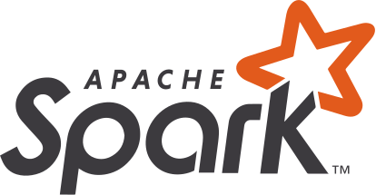
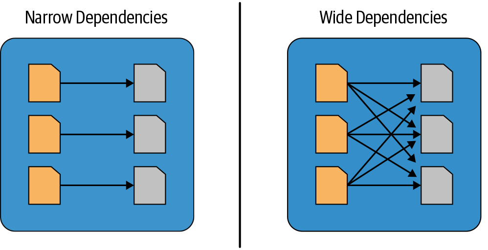
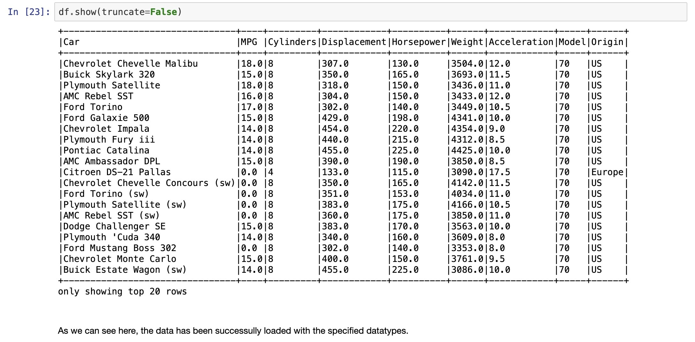

::: {.content-visible unless-format="revealjs"}

<center class='mb-3'>
<a class="h2" href="./slides.html" target="_blank">Open slides in new tab &rarr;</a>
</center>

:::

# Big Midterm $\rightarrow$ Final Project Updates {data-stack-name="Midterm &rarr; Final"}

## Pre-Approved Final Project Datasets! {.title-09}

&nbsp;

<center>

[See [**here**](../final-project/index.qmd){.external}]{.boxed-cb}

</center>

## Practice Midterm

* <i class='bi bi-1-circle'></i> Pick one of the [pre-approved datasets](../final-project/index.qmd){.external}
* <i class='bi bi-2-circle'></i> Read the corresponding **vignette** on the website
* <i class='bi bi-3-circle'></i> Answer each **practice question** based on this vignette

<center>

*Vignettes will also be provided on the paper midterm!*

</center>

# Entering Our Spark Era {.crunch-title .crunch-p .title-13 .crunch-img data-stack-name="Spark"}

```{=html}
<table>
<thead>
</thead>
<tbody>
<tr>
  <td class='tdc tdnb tdnp'><span data-qmd="<i class='bi bi-arrow-90deg-right' style='font-size: 70%;'></i> PySpark <i class='bi bi-arrow-90deg-left' style='font-size: 70%;'></i>"></span></td>
</tr>
<tr>
  <td class='tdc tdnb tdnp'><span data-qmd="{fig-align='center' width='280'}<br><i class='bi bi-arrow-down' style='font-size: 70%;'></i> <span style='font-size: 70%;'>Written in</span> <i class='bi bi-arrow-down' style='font-size: 70%;'></i>"></span></td>
</tr>
<tr>
  <td class='tdc tdnb tdnp'><span data-qmd="{fig-align='center' width='280'}<br><i class='bi bi-arrow-down' style='font-size: 70%;'></i> <span style='font-size: 70%;'>Compiles to</span> <i class='bi bi-arrow-down' style='font-size: 70%;'></i>"></span></td>
</tr>
<tr>
  <td class='tdc tdnb tdnp tdvc'>
    <div style="display: flex; align-items: center; justify-content: center; gap: 0.5em;">
    </img>
    <span>Java Virtual Machine (JVM)</span>
  </div>
  </td>
</tr>
<tr>
  <td></td>
</tr>
</tbody>
</table>
```

## Roadmap {.title-11 .text-90 .crunch-p}

*(Logistical point: [Form](https://forms.gle/i7wnwEKTuTCEPUBw7) for new AWS Canvas accounts)*

* Week 3: **Map-Reduce** $\leadsto$ Last Week: **Athena** with **AWS Glue** under the hood for "automated" ETL!
* This Week: Hitting a wall with Athena... It **doesn't know in advance what [types of] queries you're going to make!**
* If you're going to **group by** (e.g.) **state**, then rent **50 computers** to process one state each, Athena doesn't know to **place the Ohio data on the Ohio computer!**
* **Hadoop MapReduce**: Allows **"steering"** of Map-Reduced data-computation pairing

## Your Goal: Narrow Dependencies! {.smaller .crunch-title}

{.nostretch fig-align="center" width="80%"}

## First Things First: OpenJDK

* **Spark 4**: Recommended JDK version = [**21**](https://openjdk.org/projects/jdk/21/)^[[21?](https://www.youtube.com/watch?v=oe6teqX2y6Y)]
  * *(How would you know this without me telling you? Truly idk)*

``` {.bash}
sudo apt install openjdk-21-jdk-headless
```

## Getting + Using Spark

&nbsp;

<center>

[[**Apache Spark Downloads Page**](https://spark.apache.org/downloads.html){.external}]{.boxed-cb}

</center>

* <i class='bi bi-1-circle'></i> **Spark Connect** enabled ✅
* <i class='bi bi-2-circle'></i> **Click through** the ["Download Spark" link](https://www.apache.org/dyn/closer.lua/spark/spark-4.2.0/spark-4.2.0-bin-hadoop3-connect.tgz)...
* <i class='bi bi-3-circle'></i> ...To get the actual [**download URL**](https://dlcdn.apache.org/spark/spark-4.2.0/spark-4.2.0-bin-hadoop3-connect.tgz) 😵‍💫
* <i class='bi bi-4-circle'></i> Use `wget` to download

## In-Class Demo {.crunch-title .crunch-img .text-90}

{fig-align="center"}

* [Cars! Driving!](
https://colab.research.google.com/drive/1G894WS7ltIUTusWWmsCnF_zQhQqZCDOc)

::: {.aside}

Adapted from/almost identical to [Jacob Celestine's tutorial](https://jacobcelestine.com/knowledge_repo/colab_and_pyspark/)

:::

## References

::: {#refs}
:::
