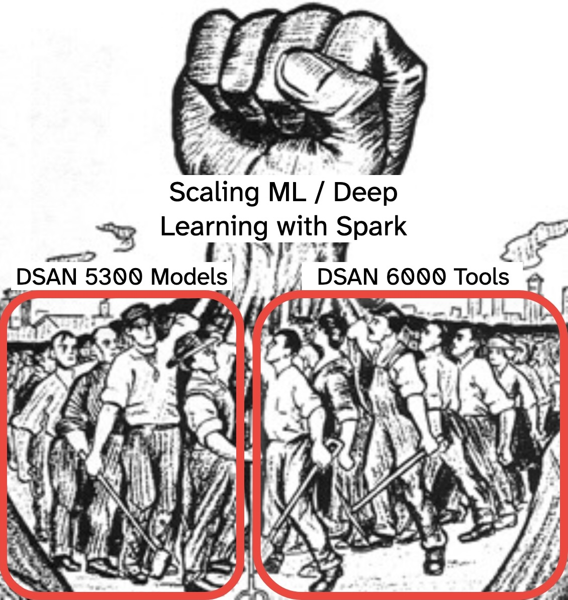

::: {.content-visible unless-format="revealjs"}

<center class='mb-3'>
<a class="h2" href="./slides.html" target="_blank">Open slides in new tab &rarr;</a>
</center>

:::

## Post-Midterm Roadmap {.crunch-title .smaller .crunch-p .crunch-img .crunch-quarto-figure .crunch-quarto-layout-panel .crunch-li-8 data-name="Roadmap"}

*Just for **this week** and **next week**, we need to **split our brains in half!***

:::: {layout="[35,30,35]" layout-align="center" layout-valign="center"}
::: {#brain-left}

<center>

**Class Material**

</center>

*This week (W10, <span class='sec-w10-date'>Nov 9</span>):*

* **Scalable ML** with Spark
* *HW7: Sun, Nov 15*

*Next week (W11, <span class='sec-w11-date'>Nov 16</span>):*

* **ETL**ing into **Vector DB**
* *HW8: Sun, Nov 22*

:::
::: {#brain-center}

](images/brain-lr-crop.png){fig-align="center" width="100%"}

:::
::: {#brain-right}

<center>

**Final Project**

</center>

*This week (W10, <span class='sec-w10-date'>Nov 9</span>):*

* Finalize topic $\leadsto$ Proposal
* *Proposal: Sun, Nov 15*

*Next week (W11, <span class='sec-w11-date'>Nov 16</span>):*

* Exploratory Data Analysis
* *EDA 1-pager: Sun, Nov 22*

:::
::::

* *<span class='sec-w115-date'>Nov 23</span>:* **No class!** Spark cluster run (*Spark 1-pager: Sun, Nov 29*)
* *W12, <span class='sec-w12-date'>Nov 30</span>:* **Informal technical presentation** (*Formal slides: Sun, Dec 6*)
* **[Formal] Final Presentations: *<span class='sec-presentation-date'>Monday, December 7</span>*** (*Report: Sun, Nov 13*)

## How Do I Pick A Project?

* [ ] Won't fit in RAM ("Raw" data or intermediate results)
* [ ] Uses **Spark cluster** with **multiple** EC2 instances
* [ ] *(Ideally)* Has both **numeric** and **text** components
  * Could just be "associated notes" (healthcare)
  * "Intake notes" (NYC shelters)
  * Or short descriptions (ACLED)
* [ ] *(Ideally)* Draws on your **domain knowledge**

## Today's Goal {.smaller .crunch-title .crunch-p .crunch-img data-name="MLlib &rarr; MLflow"}

<center>

[***Combination** of your skills > **sum of its parts!***]{.boxed-g style="padding-left: 8px !important; padding-right: 8px !important;"}

</center>

{.nostretch fig-align="center" width="50%"}

## MLlib: Hopping Up Another Abstraction Layer! {.smaller .not-title-slide .title-10}

](images/sparkml.png){.lightbox fig-align="center"}

## Numeric Features: `VectorAssembler` {.smaller .crunch-ul .crunch-p .title-12}

* MLlib models expect features to be combined into a **single column**
* For numeric data, `VectorAssembler` does what we want!

```{python}
#| label: build-sparksession
#| eval: false
from pyspark.sql import SparkSession
spark = (
  SparkSession
  .builder
  .appName('Sport_Predict')
  .getOrCreate()
)
```

:::: {.columns}
::: {.column width="50%"}

```{python}
#| label: mllib-load-data
#| echo: true
#| code-fold: true
#| eval: false
from pyspark.ml.feature import VectorAssembler
from pyspark.ml.regression import DecisionTreeRegressor
sport_sdf = (
    spark
    .read
    .option('header', 'true')
    .csv("assets/country_sports.csv")
)
sport_sdf.show()
```

```
+--------------+---------+----------+--------+
|       Country|Continent|Population|   Sport|
+--------------+---------+----------+--------+
|     Argentina|       SA|        44|  Soccer|
|     Australia|      Aus|        34| Cricket|
|        Brazil|       SA|       211|  Soccer|
|        Canada|       NA|        36|  Hockey|
|          Cuba|       NA|        11|Baseball|
|       Germany|      Eur|        80|  Soccer|
|         India|     Asia|      1342| Cricket|
|         Italy|      Eur|        59|  Soccer|
|        Russia|     Asia|       143|  Hockey|
|         Spain|      Eur|        46|  Soccer|
|United Kingdom|      Eur|        65| Cricket|
| United States|       NA|       326|Baseball|
+--------------+---------+----------+--------+
```

:::
::: {.column width="50%"}

```{python}
#| label: mllib-vector-assembler
#| echo: true
#| code-fold: true
#| eval: false
from pyspark.ml.feature import VectorAssembler, StringIndexer, OneHotEncoder
from pyspark.ml.regression import DecisionTreeRegressor
sport_sdf = (
    spark
    .read
    .option('header', 'true')
    .schema('Country STRING, Continent STRING, Population INT, Sport STRING')
    .csv("assets/country_sports.csv")
)
va = VectorAssembler(
  inputCols=['Population'],
  outputCol='features'
)
va.transform(sport_sdf).select('Country','features','Sport').show()
```

```
+--------------+--------+--------+
|       Country|features|   Sport|
+--------------+--------+--------+
|     Argentina|  [44.0]|  Soccer|
|     Australia|  [34.0]| Cricket|
|        Brazil| [211.0]|  Soccer|
|        Canada|  [36.0]|  Hockey|
|          Cuba|  [11.0]|Baseball|
|       Germany|  [80.0]|  Soccer|
|         India|[1342.0]| Cricket|
|         Italy|  [59.0]|  Soccer|
|        Russia| [143.0]|  Hockey|
|         Spain|  [46.0]|  Soccer|
|United Kingdom|  [65.0]| Cricket|
| United States| [326.0]|Baseball|
+--------------+--------+--------+
```

:::
::::

* ...What about **categorical** data?

[*(Example dataset from @leskovec_mining_2014; [Notebook here](https://github.com/jpowerj/dsan6000-w10)*]{.text-90}

## Categorical Features: `StringIndexer` + `OneHotEncoder` {.smaller .title-09 .crunch-p .crunch-ul}

:::: {.columns}
::: {.column width="40%"}

<center>

**`StringIndexer`**

</center>

```{python}
#| label: mllib-indexer
#| echo: true
#| code-fold: true
#| eval: false
si = StringIndexer(
  inputCols=['Continent'],
  outputCols=['Continent_Index'],
  handleInvalid="skip"
)
fitted_si = si.fit(sport_sdf)
sport_ci_sdf = fitted_si.transform(sport_sdf)
sport_ci_sdf.select('Country','Continent','Continent_Index').show()
```

```
+--------------+---------+---------------+
|       Country|Continent|Continent_Index|
+--------------+---------+---------------+
|     Argentina|       SA|            3.0|
|     Australia|      Aus|            4.0|
|        Brazil|       SA|            3.0|
|        Canada|       NA|            1.0|
|          Cuba|       NA|            1.0|
|       Germany|      Eur|            0.0|
|         India|     Asia|            2.0|
|         Italy|      Eur|            0.0|
|        Russia|     Asia|            2.0|
|         Spain|      Eur|            0.0|
|United Kingdom|      Eur|            0.0|
| United States|       NA|            1.0|
+--------------+---------+---------------+
```

:::
::: {.column width="60%"}

<center>

**`OneHotEncoder`**

</center>

```{python}
#| label: mllib-ohe
#| echo: true
#| code-fold: true
#| eval: false
from pyspark.ml.linalg import DenseVector
from pyspark.ml.functions import vector_to_array, array_to_vector
ohe = OneHotEncoder(
  inputCols=['Continent_Index'],
  outputCols=['Continent_OHE'],
)
fitted_ohe = ohe.fit(sport_ci_sdf)
sport_ohe_sdf = fitted_ohe.transform(sport_ci_sdf)
sport_dense_sdf = (
  sport_ohe_sdf
  .withColumn(
    "Continent_Dense",
    array_to_vector(
      vector_to_array("Continent_OHE")
    )
  )
)
(
  sport_dense_sdf
  .select('Country','Continent_Index','Continent_OHE','Continent_Dense')
).show()
```

```
+--------------+---------------+-------------+-----------------+
|       Country|Continent_Index|Continent_OHE|  Continent_Dense|
+--------------+---------------+-------------+-----------------+
|     Argentina|            3.0|(4,[3],[1.0])|[0.0,0.0,0.0,1.0]|
|     Australia|            4.0|    (4,[],[])|[0.0,0.0,0.0,0.0]|
|        Brazil|            3.0|(4,[3],[1.0])|[0.0,0.0,0.0,1.0]|
|        Canada|            1.0|(4,[1],[1.0])|[0.0,1.0,0.0,0.0]|
|          Cuba|            1.0|(4,[1],[1.0])|[0.0,1.0,0.0,0.0]|
|       Germany|            0.0|(4,[0],[1.0])|[1.0,0.0,0.0,0.0]|
|         India|            2.0|(4,[2],[1.0])|[0.0,0.0,1.0,0.0]|
|         Italy|            0.0|(4,[0],[1.0])|[1.0,0.0,0.0,0.0]|
|        Russia|            2.0|(4,[2],[1.0])|[0.0,0.0,1.0,0.0]|
|         Spain|            0.0|(4,[0],[1.0])|[1.0,0.0,0.0,0.0]|
|United Kingdom|            0.0|(4,[0],[1.0])|[1.0,0.0,0.0,0.0]|
| United States|            1.0|(4,[1],[1.0])|[0.0,1.0,0.0,0.0]|
+--------------+---------------+-------------+-----------------+
```

:::
::::

* Note 1: PySpark **automatically** chooses `SparseVector` if % non-zero is low
* Note 2: `StringIndexer` uses **`0` for most common**, **`1` for next most common**, etc.
* In `scikit-learn` we'd be ready to go! In MLlib...

## Map-Reduced vs. Serial Algorithms {.smaller .crunch-title}

:::: {.columns}
::: {.column width="50%"}

{fig-align="center" width="80%"}

:::
::: {.column width="50%"}

* **Decision Trees**: Optimal split $s^*$ $\overset{\tiny\text{def}}{\small{=}}$ a constant value $c^*$ for feature $j^*$ such that *«go left if $x_{ij^*} \leq s^*$»* produces **maximum reduction in uncertainty about label (entropy)**
* Maximum over what? **All data**
* ...But workers **don't have all data!**
* $\Rightarrow$ `spark.ml` can't use same algorithm as `scikit-learn`!
* Uses **distributed** DT learner instead: [[Planet]{.alg}](https://ir.cs.georgetown.edu/cs422/files/DM-DistributedDT.pdf)

:::
::::

## Why Do You Need To Know These Details? {.title-08 .crunch-ul .crunch-p}

```{=html}
<style>
.reveal pre.sourceCode.default code {
  white-space: wrap;
}
.reveal pre.sourceCode.default code > * {
  color: #f20000;
}
</style>
```

``` {.python}
from pyspark.ml.regression import DecisionTreeRegressor 
dt = DecisionTreeRegressor(labelCol="price")
dt_model = dt.fit(train_sdf)
```

``` {.default code-line-numbers="false"}
java.lang.IllegalArgumentException: requirement failed: DecisionTree requires maxBins (= 32) to be at least as large as the number of values in each categorical feature, but categorical feature 3 has 36 values. Consider removing this and other categorical features with a large number of values, or add more training examples.
```

::: {.text-85 .inline-80}

* `scikit-learn` **has no `maxBins` parameter**
* `spark.ml` [does](https://spark.apache.org/docs/latest/api/python/reference/api/pyspark.ml.regression.DecisionTreeRegressor.html#pyspark.ml.regression.DecisionTreeRegressor.maxBins), and it's important!
* Should be **power of 2**, and the next one above the default value (`64`) can **massively increase computation time** for datasets with many categorical features

*(Many `spark.ml` algorithms also fail if \# features $p > 4096$...)*

:::

## Final Note: *Different* Algorithms for Long vs. Wide {.smaller .title-10 .crunch-img .crunch-quarto-figure .crunch-ul .crunch-li-8}

:::: {.columns}
::: {.column width="50%"}

![[Planet]{.alg}: MLlib's default DT learner when \# features $p \leq 4096$. From @abuzaid_yggdrasil_2016](images/planet.svg){.nostretch fig-align="center" width="380"}

:::
::: {.column width="50%"}

![MLlib **switches over** to [Yggdrasil]{.alg} when \# features $p > 4096$. Also @abuzaid_yggdrasil_2016... Unrelated to [YGG Tay](https://youtu.be/u5K0hFhXLus?si=6_RWKfoVzUfD_67O)](images/yggdrasil.svg){.nostretch fig-align="center" width="340"}

:::
::::

* *Note that this switching occurs when Spark hits its **hard constraint**: $p \leq 4096$*
* **You** may want to **switch it manually**... ***When would this be helpful?*** [In which Jeff sits in silence until his heart explodes]{style="font-size: 20%"}

## In-Class Demo 3

&nbsp;

<center>

[[**MLlib in Action**](https://colab.research.google.com/drive/1JmUjc65mEucPW0bZHHjzmt812oiIXeVE?usp=sharing)]{.boxed-cb}

</center>

* [Backup repo](https://github.com/jpowerj/dsan6000-w10)

## Spark NLP {.smaller .crunch-title data-name="Spark NLP"}

:::: {.columns}
::: {.column width="50%"}

**MLlib**: `pyspark` as normal:

``` {.python}
from pyspark.sql import SparkSession
spark = (
    SparkSession
    .builder
    .appName('My_ML_App')
    .getOrCreate()
)
type(spark)
# >>> pyspark.sql.session.SparkSession
from pyspark.ml.feature import VectorAssembler
```

**Spark NLP**: *Custom* `SparkSession` with `sparknlp.start()`:

``` {.python}
import sparknlp
spark = sparknlp.start()
type(spark)
# >>> pyspark.sql.session.SparkSession
from sparknlp.base import DocumentAssembler
```

:::
::: {.column width="50%"}

 book](images/sparknlp.jpg){.nostretch fig-align="center" width="360"}

:::
::::

## In-Class Demo 4

&nbsp;

<center>

[[**Distributed Sentiment Analysis with Spark NLP**](https://colab.research.google.com/drive/1CMokcCj4W0qruH946Y7dYeWYrE62iXkK?usp=sharing)]{.boxed-cb}

</center>

* [Backup repo](https://github.com/jpowerj/dsan6000-w10)

## References

::: {#refs}
:::
