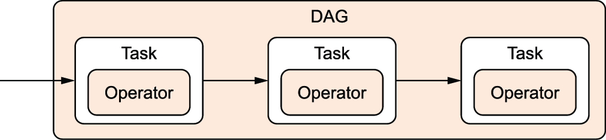
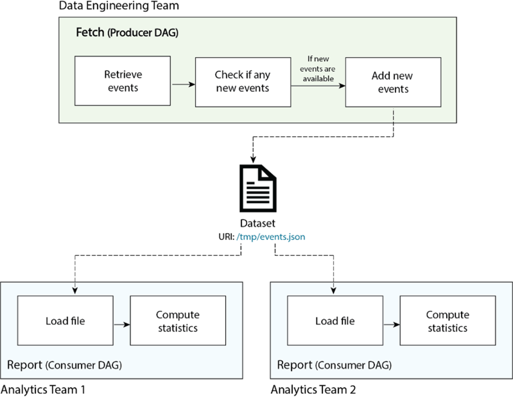
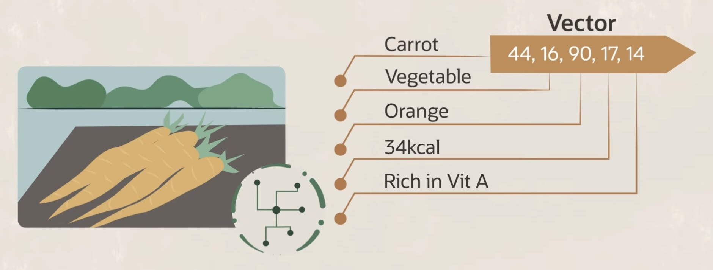
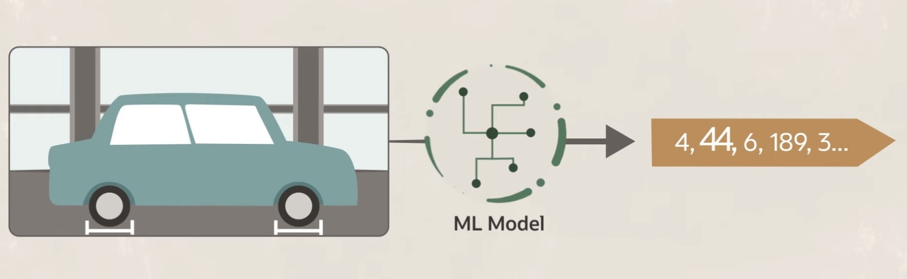
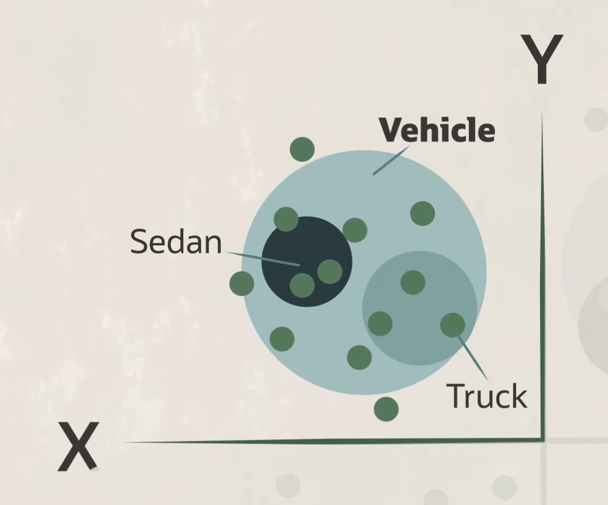
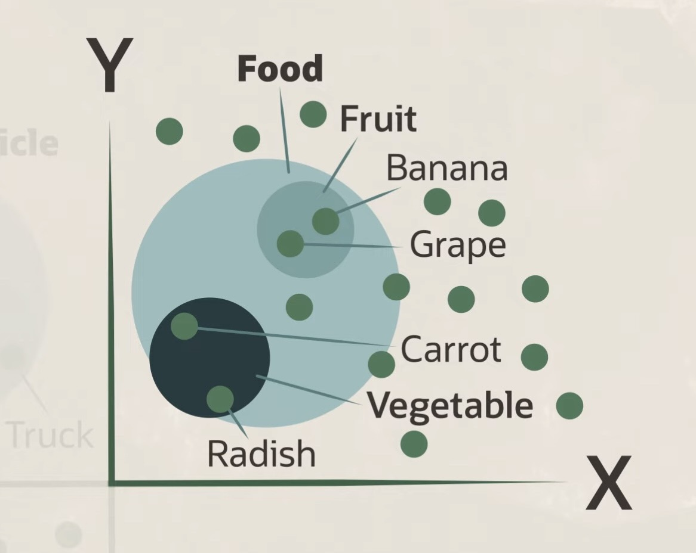
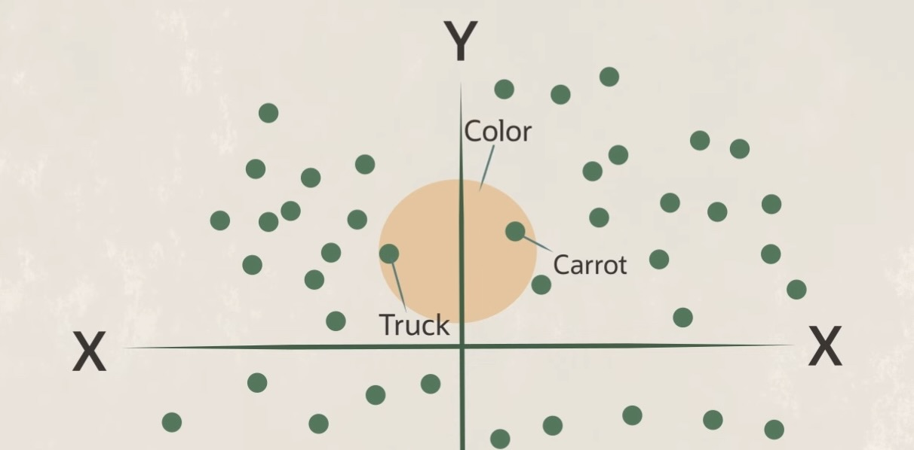
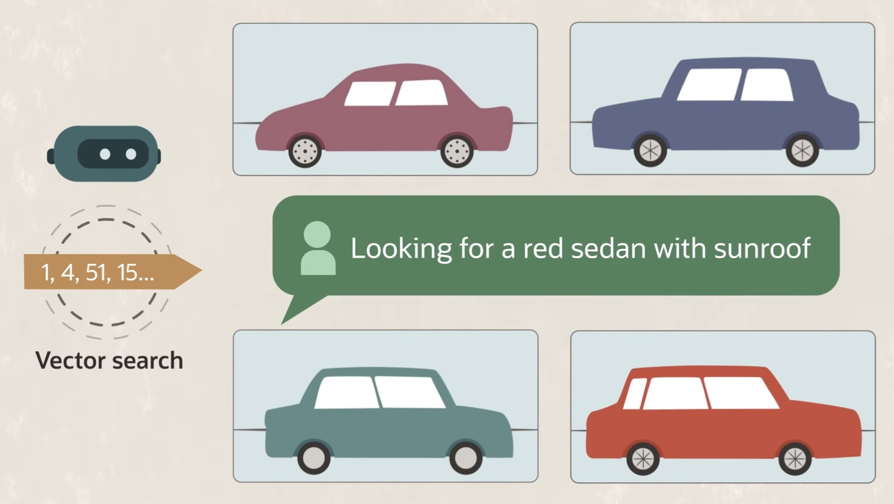

::: {.content-visible unless-format="revealjs"}

<center class='mb-3'>
<a class="h2" href="./slides.html" target="_blank">Open slides in new tab &rarr;</a>
</center>

:::

## Pipelines for *Triggered* Execution {.text-85 .crunch-title .crunch-quarto-layout-panel .crunch-quarto-layout-cell .crunch-p .crunch-ul .crunch-li-8 .crunch-img data-name="Key Concepts"}

<!-- https://projects.verou.me/bubbly/ -->

```{=html}
<style>
.speech-bubble {
	position: relative;
	background: #e69f00;
	border-radius: .3em;
  padding-left: 10px;
  padding-right: 10px;
  padding-top: 8px;
  padding-bottom: 8px;
}

.speech-bubble:after {
	content: '';
	position: absolute;
	left: 0;
	top: 50%;
	width: 0;
	height: 0;
	border: 24px solid transparent;
	border-right-color: #e69f00;
	border-left: 0;
	border-bottom: 0;
	margin-top: -12px;
	margin-left: -24px;
}
</style>
```

<center>

:::: {layout="[90,10]" layout-valign="center"}
::: {.column width="90%"}

[***...HEY! WAKE UP! NEW DATA JUST CAME IN!***]{.speech-bubble style="float: right;"}

:::
::: {.column width="10%"}

{width="90" style="float: left;"}

:::
::::

</center>

:::: {.columns}
::: {.column width="50%"}

<center>

You before this week:

</center>

* Sprint to your `.ipynb` and/or Spark cluster
* Load, clean, process new data, manually, step-by-step
* Email update to boss

<center>

{width="44%" fig-align="center"}

</center>

:::
::: {.column width="50%"}

<center>

You after this week:

</center>

* [Asset-aware](https://airflow.apache.org/docs/apache-airflow/stable/authoring-and-scheduling/asset-scheduling.html) pipeline automatically triggered
* Airflow **orchestrates** loading, cleaning, processing
* `EmailOperator` sends update

<center>

{width="50%" fig-align="center"}

</center>

:::
::::

## Pipelines vs. Pipeline *Orchestration* {.smaller .title-12}

](images/orchestration.jpeg){fig-align="center"}

## Key Airflow-Specific Buzzwords {.text-75}

*(Underlined words link to Airflow docs ["Core Concepts" section](https://airflow.apache.org/docs/apache-airflow/stable/core-concepts/overview.html))*

* [**Directed Acyclic Graph (`DAG`)**](https://airflow.apache.org/docs/apache-airflow/stable/core-concepts/dags.html){.under}: Your pipeline as a whole!
* `DAG`s consist of **multiple** [**`task`s**](https://airflow.apache.org/docs/apache-airflow/stable/core-concepts/tasks.html){.under}, which you "string together" using the [**control flow**](https://airflow.apache.org/docs/apache-airflow/stable/core-concepts/overview.html#control-flow) operators `>>` and `<<`
* [Ex <i class='bi bi-1-circle' style='font-size: 90%;'></i>] `second_task`, `third_task` can't start until `first_task` completes:
  ``` {.python}
  first_task >> [second_task, third_task]
  # Equivalent to:
  first_task.set_downstream([second_task, third_task])
  ```
* [Ex <i class='bi bi-2-circle' style='font-size: 90%;'></i>] `fourth_task` can't start until `third_task` completes:
  ``` {.python}
  fourth_task << third_task
  # Equivalent to:
  fourth_task.set_upstream(third_task)
  ```
* What *kinds* of `task`s can we create? Brings us to another concept...

## `Operator`s: What *Kind* of `task`? {.text-90 .crunch-ul .crunch-quarto-layout-panel .li-even}

* "Core" `Operator`s: [`BashOperator`](https://airflow.apache.org/docs/apache-airflow-providers-standard/stable/_api/airflow/providers/standard/operators/bash/index.html#airflow.providers.standard.operators.bash.BashOperator) and [`PythonOperator`](https://airflow.apache.org/docs/apache-airflow-providers-standard/stable/_api/airflow/providers/standard/operators/python/index.html#airflow.providers.standard.operators.python.PythonOperator)

:::: {layout="[1,1]" layout-valign="default"}
::: {.column width="50%"}

* \+ Hundreds of "community provider" `Operator`s:
* `HttpOperator`
* `S3FileTransformOperator`
* `SQLExecuteQueryOperator`
* `EmailOperator`
* `SlackAPIOperator`

:::
::: {.column width="50%"}

\+ [`Jinja` templating](https://airflow.apache.org/docs/apache-airflow/stable/core-concepts/operators.html#jinja-templating) for managing how data "passes" from one step to the next:

{fig-align="center"}

<!-- https://edotor.net/?engine=dot?engine=dot#digraph%20G%20%7B%0A%20%20%20%20rankdir%3D%22LR%22%3B%0A%09edge%20%5Bpenwidth%3D0.75%2Carrowsize%3D0.6%5D%0A%20%20%20%20%23%20results%0A%09csv%20%5Blabel%3D%22CSV%22%5D%3B%0A%09json%20%5Blabel%3D%22JSON%22%5D%3B%0A%09pl%20%5Blabel%3D%22Python%20lists%22%5D%3B%0A%20%20%20%20logs%20%5Blabel%3D%22Logged%20outputs%22%5D%3B%0A%20%20%20%20%23%20%3F%0A%20%20%20%20qm%20%5Blabel%3D%22%3F%3F%3F%22%5D%3B%0A%20%20%20%20%23%20summaries%0A%20%20%20%20email%20%5Blabel%3D%22Email%20%2F%20Text%20message%22%5D%0A%20%20%20%20slack%20%5Blabel%3D%22Slack%20message%22%5D%0A%09%23text%20%5Blabel%3D%22Text%20message%22%5D%0A%20%20%20%20reports%20%5Blabel%3D%22Markdown%20report%22%5D%0A%09subgraph%20cluster_G1%20%7B%0A%20%20%20%20%20%20%20%20style%3D%22dashed%22%3B%0A%09%09%09%09label%3D%22Messy%20Pipeline%20Results%22%0A%09%09%09%09csv%3B%0A%09%09%09%09json%3B%0A%09%09%09%09pl%3B%0A%20%20%20%20%20%20%20%20%20%20%20%20%20%20%20%20logs%3B%0A%09%7D%0A%09subgraph%20cluster_G2%20%7B%0A%20%20%20%20%20%20%20%20style%3D%22dashed%22%3B%0A%09%09%09%09label%3D%22Clean%20Summaries%22%0A%09%09%09%09email%3B%0A%20%20%20%20%20%20%20%20%20%20%20%20%20%20%20%20slack%3B%0A%20%20%20%20%20%20%20%20%20%20%20%20%20%20%20%20%23text%3B%0A%20%20%20%20%20%20%20%20%20%20%20%20%20%20%20%20reports%3B%0A%09%7D%0A%20%20%20%20csv%20-%3E%20qm%3B%0A%20%20%20%20json%20-%3E%20qm%3B%0A%20%20%20%20pl%20-%3E%20qm%3B%0A%20%20%20%20logs%20-%3E%20qm%3B%0A%20%20%20%20qm%20-%3E%20email%3B%0A%20%20%20%20qm%20-%3E%20slack%3B%0A%20%20%20%20%23qm%20-%3E%20text%3B%0A%20%20%20%20qm%20-%3E%20reports%3B%0A%7D%0A -->

:::
::::

## `Task` vs. `Operator`: A Sanity-Preserving Distinction {.smaller .title-09 .crunch-title .crunch-blockquote .crunch-quarto-figure}

*From [`Operator`](https://airflow.apache.org/docs/apache-airflow/stable/core-concepts/operators.html) docs:*

> *When we talk about a `Task`, we mean the **generic** "unit of execution" of a `DAG`; when we talk about an `Operator`, we mean a **[specific] pre-made `Task` template**, whose logic is all done for you and that **just needs some arguments**.*

:::: {.columns}
::: {.column width="50%"}

<center>

`Task`:

</center>

{fig-align="center" width="90%"}

:::
::: {.column width="50%"}

<center>

`Operator`:

</center>

{fig-align="center" width="60%"}

:::
::::

{fig-align="center" width="60%"}

## Concepts $\leadsto$ Code {.crunch-title .crunch-ul}

``` {.bash filename="start-airflow.sh"}
airflow db migrate
airflow api-server --port 8080
airflow scheduler
airflow dag-processor
airflow triggerer
```

:::: {.columns}
::: {.column width="50%"}

* Full Airflow "ecosystem" is running once you've started each piece via above (`bash`) commands!
* Let's look at each in turn... [**(Optional) Bonus slides!**](../writeups/airflow/index.qmd){.external target='_blank'}

:::
::: {.column width="50%"}

{fig-align="center" width="400"}

:::
::::

## The Payoff: *Downstream* Consumers Can Establish Their Own Triggered Execution(s)! {.smaller .title-11}

{fig-align="center"}

# What are we **L**oading Into? {data-stack-name="Unstructured Data"}

## Our Working ETL Example {.smaller .crunch-title .crunch-ul .table-80}

```{=html}
<style>
details.spoiler {
	display: inline;
	cursor: pointer;
  font-size: 1.2rem !important;

	summary {
		display: inline;
    color: black;
		background: black;
		padding-inline: 0.25rem;
		border-radius: 0.2rem;
		user-select: none;
		transition: opacity 0.2s ease;
    font-size: 1.5rem !important;

		&:hover {
			opacity: 0.75;
		}
	}
  summary > * {
    color: black;
    font-size: 1.5rem !important;
  }

	&[open] summary {
    display: inline;
		background: #1c1c1c;
		color: white;
	}
  &[open] summary > * {
    display: inline;
    color: unset;
  }
}
</style>
```

* **Extract** text from OLTP, **Transform** by **embedding** into semantic vector space
* **Load** into... OLAP DB, but what kind? Data Lake? ❌ Warehouse? ❌

```{=html}
<table>
<colgroup>
<col style='width: 7%;'>
<col style='width: 49%;'>
<col style='width: 11%;'>
<col style='width: 11%;'>
<col style='width: 5%;'>
<col style='width: 11%;'>
<col style='width: 6%;'>
</colgroup>
<thead>
<tr>
  <th class='tdvc tdc' rowspan='2'>name</th>
  <th class='tdvc' rowspan='2'>message</th>
  <th class='tdc tdvc' colspan='4'>embedding</th>
  <th class='tdc tdvc' rowspan='2'>label</th>
</tr>
<tr>
    <th align='center'>dim<sub>1</sub></th>
  <th align='center'>dim<sub>2</sub></th>
  <th align='center'><span data-qmd="$\cdots$"></span></td>
  <th align='center'>dim<sub>3072</sub></th>
</tr>
</thead>
<tbody>
<tr>
  <td><span data-qmd="Fangzhou"></span></td>
  <td><span data-qmd="`card broke in half`"></span></td>
  <td class='tdc'><span data-qmd="`[0.8723`"></span></td>
  <td class='tdc'><span data-qmd="`0.7536`"></span></td>
  <td class='tdc'><span data-qmd="$\cdots$"></span></td>
  <td class='tdc'><span data-qmd="`0.8022]`"></span></td>
  <td class='tdc'><span data-qmd="`card_issue`"></span></td>
</tr>
<tr>
  <td class='tdc tdvc'>Samyu</td>
  <td><span data-qmd="`accidentally folded card into möbius strip, cant figure out which part is the back`"></span></td>
  <td class='tdc tdvc'><span data-qmd="`[0.1296`"></span></td>
  <td class='tdc tdvc'><span data-qmd="`0.5923`"></span></td>
  <td class='tdc tdvc'><span data-qmd="$\cdots$"></span></td>
  <td class='tdc tdvc'><span data-qmd="`0.1105]`"></span></td>
  <td class='tdc tdvc'><span data-qmd="`NA` (❓)"></span></td>
</tr>
<tr>
  <td class='tdc tdvc'><span data-qmd="Jeff"></span></td>
  <td><span data-qmd="`off the lean in italy like i was pisa, put it on the mastercard, already owe visa`"></span></td>
  <td class='tdc tdvc'><span data-qmd="`[0.2399`"></span></td>
  <td class='tdc tdvc'><span data-qmd="`0.0656`"></span></td>
  <td class='tdc tdvc'><span data-qmd="$\cdots$"></span></td>
  <td class='tdc tdvc'><span data-qmd="`0.0967]`"></span></td>
  <td class='tdc tdvc'><span data-qmd="`rapping`"></span></td>
</tr>
</tbody>
</table>
```

* In fact, **none** of the approaches thus far (whether OLTP or OLAP) are very helpful for this case: "standard" **tabular** storage fails to capture **spatial structure**...


## Intuition: ...Why Did We "Split" OLAP from OLTP in the First Place? {.smaller .crunch-p}

::: {#intuition-head style="width: 100%; margin-bottom: 14px;"}

*The answer: Different **use cases** $\Rightarrow$ Optimizing for different **"critical operations"***

:::

:::: {.columns}
::: {.column width="50%"}

<center>

**OLTP**

</center>

* Optimized for rapid **insertion**
* Ex: Append-only logs, website events, sensor readings
* ...Vector DBs? ❌ Not typically a critical operation (vectors can be inserted offline/overnight at pace chosen by engineers)

:::
::: {.column width="50%"}

<center>

**OLAP**

</center>

* Optimized for rapid **vectorized columnar computations** (across many observations at once)
* Ex: `(df['y'] - df['yhat'])^2`
* Vector DBs? ❌ Each observation has not 1 but (say) 3,072 *non-independent* attributes; a single column 

:::
::::

* Critical operation for Vector DBs? **Nearest-neighbors search**
* Need a **data structure** that *forces* records **close** in vector space to be **close** in DB... Spoiler ([](https://jimkang.com/quadtreevis/)): <details class='spoiler'><summary>`QuadTree`!</summary></details>

# Vector Spaces: The Geometry of AI! {.not-title-slide .smaller .crunch-title .title-12 data-stack-name="Embeddings Overview"}

:::: {.columns}
::: {.column width="50%"}

](images/vector-space-query.jpeg){fig-align="center"}

:::
::: {.column width="50%"}

* Why **vector** spaces over **keyword** matching?
* What if words have different **meanings** in different **contexts**?

:::
::::

## Word Counts: Good Enough? {.smaller .crunch-title .title-12}

Just four keywords per section:

| Section | Keywords |
|------|-------|
| U.S. | `state`, `court`, `federal`, `republican` |
| World | `government`, `country`, `officials`, `minister` |
| Arts | `music`, `show`, `art`, `dance` |
| Sports | `game`, `league`, `team`, `coach` |
| Real Estate | `home`, `bedrooms`, `bathrooms`, `building` |

For each article, vote for section with highest keyword count:

| | Arts | Real Estate | Sports | U.S. News | World News | Total |
|-|------|-------------|--------|-----------|------------|------|
| Correct | 3020 | 690 | 4860 | 1330 | 1730 | **11630** |
| Incorrect | 750 | 60 | 370 | 1100 | 590 | **2870** |
| Accuracy | **0.801** | **0.920** | **0.929** | <span class="redbox">**0.547**</span> | <span class="redbox">**0.746**</span> | **0.802** |

## What's Missing? Context! {.crunch-title}

::: {.callout-note appearance="minimal"}

*You shall know a word by the company it keeps.* [@firth_papers_1957]

:::

:::: {.columns style="font-size: 75%;"}
::: {.column width="50%"}

<center>

**Article A** (World News):

</center>

<!-- President Vladimir V. Putin told Russia's natural gas monopoly, Gazprom, on Saturday to continue selling subsidized gas to Ukraine until the end of March if Ukraine agrees to pay market prices beginning in April. Mr. Putin's order, delivered on national television as Gazprom threatened to cut off gas exports for Ukraine beginning on Jan. 1, put Russia's president in the center of a dispute that has caused Europe to worry whether its gas supply will be disrupted in the January chill. Ukraine replied warily. The office of President Viktor A. Yushchenko noted that ''negotiations of the settlement of the gas problem have crossed into a new phase.'' A spokesman for Yury I. Yekhanurov, Ukraine's prime minister, was quoted by Interfax saying that Ukraine agreed to a transition to market prices, but the details require negotiations. Mr. Putin gave Ukraine until midnight Saturday to accept his terms. -->

**President Bush** said he was trying to convince **President Vladimir Putin** of Russia that cooperation was "in Russia's security interests," even though Defense Secretary Robert M. Gates did not win Mr. Putin's support during a trip to Moscow last week.

["Bush Steps Up Effort to Persuade Putin on Missile Defense Plan"](https://www.nytimes.com/2007/05/01/world/europe/01prexy.html), *NYTimes*, 1 May 2007.

:::
::: {.column width="50%"}

<center>

**Article B** (U.S. News):

</center>

**President Bush** began his day yesterday at dawn on the **golf** course. He began Saturday on the golf course, too. A weekend earlier, the president played two rounds of 18 holes on the course at Andrews Air Force Base just outside Washington.

["White House Letter; Bush Makes Quick Work of Relaxing"](https://www.nytimes.com/2002/08/05/us/white-house-letter-bush-makes-quick-work-of-relaxing.html), *NYTimes*, 5 August 2002.

:::
::::


## Basic Context Engineering {.smaller .text-65 .crunch-title .inline-90 .crunch-ul .crunch-li-8}

* What exactly do we mean when we say **"context"**?
* Different **training objectives** give different types of contexts!
* Example: Closest vectors to **Turing**, trained on Wikipedia in two ways:

<br>

<table>
<thead>
<tr>
<th></th>
<th class="bb" width="25%">Dependency Tree</th>
<th>5-Word Window</th>
<th></th>
</tr>
</thead>
<tbody>
<tr>
<td class="bb tb">Same category $\rightarrow$</td>
<td class="ln tb bn">Pauling</td>
<td class="rn bn lb">nondeterministic</td>
<td class="bb">$\leftarrow$ Topically related</td>
</tr>
<tr>
<td class="bn tdc">*(Paradigmatic)*</td>
<td class="lb bn">Hotelling</td>
<td class="rb bn">computability</td>
<td class="bn tdc">*(Syntagmatic)*</td>
</tr>
<tr>
<td class="bn"></td>
<td class="lb bn">Lessing</td>
<td class="rb bn">deterministic</td>
<td class="bn"></td>
</tr>
<tr>
<td></td>
<td class="lb bb">Hamming</td>
<td class="rb bb">finite-state</td>
<td class="bn"></td>
</tr>
</tbody>
<caption style='text-align: center; font-size: 90%;'>Example from Uber AI Labs' amazing [Piero Molina](https://w4nderlu.st/teaching/word-embeddings)</caption>
</table>

## Pretentious But Helpful Terms! {.smaller .crunch-title}

* **Paradigmatic** $\approx$ Grammatical "substitutes", drawn from same category/type
* **Syntagmatic** $\approx$ semantic relationships between words in a sentence

<br>

<style>
.top-cb1 {
  border-top: 3px solid #e69f00 !important;
}
.left-cb1 {
  border-left: 3px solid #e69f00 !important;
}
.right-cb1 {
  border-right: 3px solid #e69f00 !important;
}
.bottom-cb1 {
  border-bottom: 3px solid #e69f00 !important;
}
.top-cb2 {
  border-top: 3px solid #56b4e0 !important;
}
.left-cb2 {
  border-left: 3px solid #56b4e0 !important;
}
.right-cb2 {
  border-right: 3px solid #56b4e0 !important;
}
.bottom-cb2 {
  border-bottom: 3px solid #56b4e0 !important;
}
.bg-mix {
  background-color: #9EAA7550 !important;
}
.top-mix {
  border-top: 3px solid #9EAA7590 !important;
}
.bottom-mix {
  border-bottom: 3px solid #9EAA7590 !important;
}
.left-mix {
  border-left: 3px solid #9EAA7590 !important;
}
.right-mix {
  border-right: 3px solid #9EAA7590 !important;
}
.top-none {
  border-top: 0px solid white !important;
}
.bottom-none {
  border-bottom: 0px solid white !important;
}
.right-none {
  border-right: 0px solid white !important;
}
.left-none {
  border-left: 0px solid white !important;
}
</style>

<table>
<thead>
<tr>
  <th class='bottom-none'></th>
  <th class='top-cb2 left-cb2 right-cb2 cb2a-bg' align="center">Paradigmatic<br>&darr;</th>
  <th class='bottom-none'></th>
  <th class='top-cb2 left-cb2 right-cb2 cb2a-bg' align="center">Paradigmatic<br>&darr;</th>
  <th class='bottom-none'></th>
</tr>
</thead>
<tbody>
<tr>
  <td class='top-none bottom-none'></td>
  <td class='tdc bg-mix top-cb1 left-cb1 bottom-cb1 right-mix'>`apples`</td>
  <td class='tdc cb1a-bg top-cb1 bottom-cb1 right-none left-mix'>&larr; **Syntagmatic** &rarr;</td>
  <td class='tdc bg-mix top-cb1 right-cb1 bottom-cb1 left-mix'>`sweet`</td>
  <td class='bottom-none'></td>
</tr>
<tr>
  <td class='top-none'></td>
  <td class='tdc bg-mix left-cb1 bottom-cb1 top-cb1 right-mix'>`oranges`</td>
  <td class='tdc cb1a-bg top-cb1 bottom-cb1 right-none left-none'>&larr; **Syntagmatic** &rarr;</td>
  <td class='tdc bg-mix top-cb1 right-cb1 bottom-cb1 left-mix'>`sour`</td>
  <td></td>
</tr>
<tr>
  <td class='tdc' style='font-size: 150%;'>These</td>
  <td class='tdc left-cb2 right-cb2 bottom-cb2' style='font-size: 150%;'>$\underline{\hspace{32mm}}$</td>
  <td class='tdc' style='font-size: 150%;'>taste very</td>
  <td class='tdc left-cb2 right-cb2 bottom-cb2' style='font-size: 150%;'>$\underline{\hspace{32mm}}$</td>
  <td class='tdc' style='font-size: 150%;'>!</td>
</tr>
</tbody>
<caption style='font-size: 90%; text-align: center;'><br>*(Both terms from @saussure_course_1916)*</caption>
</table>


## How Do We Actually *Get* These Vectors? {.smaller .crunch-title .crunch-ul .title-11 .inline-90}

::: {.r-stretch}

{fig-align="center"}

:::

* *High-level goal*: **Retain** information about **word-context relationships** while **reducing** the $M$-dimensional representations of each word down to 3 dimensions.
* *Low-level goal*: Generate **rank-$K$** matrix $\mathbf{W}$ which **best approximates** distances between words in $M$-dimensional space (rows in $\mathbf{X}$)

# Now We Put These Embeddings (Vectors) into *Databases* {data-stack-name="Vector Databases"}

* The goal: identify **similar** object as vectors "close to" the location (in vector space) of a given **query**

## Vector Search Workflow

](images/vector_search.png){fig-align="center"}

## Unstructured Data $\leadsto$ Structured Geometric Query Space {.smaller .crunch-title .crunch-img}

::: {#fig-embed-images}

{fig-align="center" width="60%"}

{fig-align="center" width="60%"}

[Image Source](https://www.youtube.com/watch?v=ebMkbWzFCnA&t=80s)
:::

## More Data $\leadsto$ "Increasing Returns" {.smaller .crunch-title .crunch-img .crunch-quarto-figure}

:::: {layout="[[1,1],[1]]" layout-valign="center"}

::: {.cap-right}

{fig-align="right" width="260"}

:::

::: {.cap-left}

{fig-align="left" width="274"}

:::

{fig-align="center" width="570"}

::::

## Queries Embedded via the *Same* Model! {.smaller .crunch-title .title-11}

{fig-align="center"}

## In-Class Demo: Vector DBs

[[https://github.com/jpowerj/dsan6000-vectordb-demo](https://github.com/jpowerj/dsan6000-vectordb-demo)}{.boxed-cb}

## References

::: {#refs}
:::
