::: {.content-visible unless-format="revealjs"}

<center class='mb-3'>
<a class="h2" href="./slides.html" target="_blank">Open slides in new tab &rarr;</a>
</center>

:::

## Pipelines for *Triggered* Execution {.text-85 .crunch-title .crunch-quarto-layout-panel .crunch-quarto-layout-cell .crunch-p .crunch-ul .crunch-li-8 .crunch-img data-name="Key Concepts"}

<!-- https://projects.verou.me/bubbly/ -->

```{=html}
<style>
.speech-bubble {
	position: relative;
	background: #e69f00;
	border-radius: .3em;
  padding-left: 10px;
  padding-right: 10px;
  padding-top: 8px;
  padding-bottom: 8px;
}

.speech-bubble:after {
	content: '';
	position: absolute;
	left: 0;
	top: 50%;
	width: 0;
	height: 0;
	border: 24px solid transparent;
	border-right-color: #e69f00;
	border-left: 0;
	border-bottom: 0;
	margin-top: -12px;
	margin-left: -24px;
}
</style>
```

<center>

:::: {layout="[90,10]" layout-valign="center"}
::: {.column width="90%"}

[***...HEY! WAKE UP! NEW DATA JUST CAME IN!***]{.speech-bubble style="float: right;"}

:::
::: {.column width="10%"}

{width="90" style="float: left;"}

:::
::::

</center>

:::: {.columns}
::: {.column width="50%"}

<center>

You before this week:

</center>

* Sprint to your `.ipynb` and/or Spark cluster
* Load, clean, process new data, manually, step-by-step
* Email update to boss

<center>

{width="44%" fig-align="center"}

</center>

:::
::: {.column width="50%"}

<center>

You after this week:

</center>

* [Asset-aware](https://airflow.apache.org/docs/apache-airflow/stable/authoring-and-scheduling/asset-scheduling.html) pipeline automatically triggered
* Airflow **orchestrates** loading, cleaning, processing
* `EmailOperator` sends update

<center>

{width="50%" fig-align="center"}

</center>

:::
::::

## Pipelines vs. Pipeline *Orchestration*

](images/orchestration.jpeg){fig-align="center"}

## Key Airflow-Specific Buzzwords {.text-75}

*(Underlined words link to Airflow docs ["Core Concepts" section](https://airflow.apache.org/docs/apache-airflow/stable/core-concepts/overview.html))*

* [**Directed Acyclic Graph (`DAG`)**](https://airflow.apache.org/docs/apache-airflow/stable/core-concepts/dags.html){.under}: Your pipeline as a whole!
* `DAG`s consist of **multiple** [**`task`s**](https://airflow.apache.org/docs/apache-airflow/stable/core-concepts/tasks.html){.under}, which you "string together" using the [**control flow**](https://airflow.apache.org/docs/apache-airflow/stable/core-concepts/overview.html#control-flow) operators `>>` and `<<`
* [Ex <i class='bi bi-1-circle' style='font-size: 90%;'></i>] `second_task`, `third_task` can't start until `first_task` completes:
  ``` {.python}
  first_task >> [second_task, third_task]
  # Equivalent to:
  first_task.set_downstream([second_task, third_task])
  ```
* [Ex <i class='bi bi-2-circle' style='font-size: 90%;'></i>] `fourth_task` can't start until `third_task` completes:
  ``` {.python}
  fourth_task << third_task
  # Equivalent to:
  fourth_task.set_upstream(third_task)
  ```
* What *kinds* of `task`s can we create? Brings us to another concept...

## `Operator`s: What *Kind* of `task`? {.text-90 .crunch-ul .crunch-quarto-layout-panel .li-even}

* "Core" `Operator`s: [`BashOperator`](https://airflow.apache.org/docs/apache-airflow-providers-standard/stable/_api/airflow/providers/standard/operators/bash/index.html#airflow.providers.standard.operators.bash.BashOperator) and [`PythonOperator`](https://airflow.apache.org/docs/apache-airflow-providers-standard/stable/_api/airflow/providers/standard/operators/python/index.html#airflow.providers.standard.operators.python.PythonOperator)

:::: {layout="[1,1]" layout-valign="default"}
::: {.column width="50%"}

* \+ Hundreds of "community provider" `Operator`s:
* `HttpOperator`
* `S3FileTransformOperator`
* `SQLExecuteQueryOperator`
* `EmailOperator`
* `SlackAPIOperator`

:::
::: {.column width="50%"}

\+ [`Jinja` templating](https://airflow.apache.org/docs/apache-airflow/stable/core-concepts/operators.html#jinja-templating) for managing how data "passes" from one step to the next:

{fig-align="center"}

<!-- https://edotor.net/?engine=dot?engine=dot#digraph%20G%20%7B%0A%20%20%20%20rankdir%3D%22LR%22%3B%0A%09edge%20%5Bpenwidth%3D0.75%2Carrowsize%3D0.6%5D%0A%20%20%20%20%23%20results%0A%09csv%20%5Blabel%3D%22CSV%22%5D%3B%0A%09json%20%5Blabel%3D%22JSON%22%5D%3B%0A%09pl%20%5Blabel%3D%22Python%20lists%22%5D%3B%0A%20%20%20%20logs%20%5Blabel%3D%22Logged%20outputs%22%5D%3B%0A%20%20%20%20%23%20%3F%0A%20%20%20%20qm%20%5Blabel%3D%22%3F%3F%3F%22%5D%3B%0A%20%20%20%20%23%20summaries%0A%20%20%20%20email%20%5Blabel%3D%22Email%20%2F%20Text%20message%22%5D%0A%20%20%20%20slack%20%5Blabel%3D%22Slack%20message%22%5D%0A%09%23text%20%5Blabel%3D%22Text%20message%22%5D%0A%20%20%20%20reports%20%5Blabel%3D%22Markdown%20report%22%5D%0A%09subgraph%20cluster_G1%20%7B%0A%20%20%20%20%20%20%20%20style%3D%22dashed%22%3B%0A%09%09%09%09label%3D%22Messy%20Pipeline%20Results%22%0A%09%09%09%09csv%3B%0A%09%09%09%09json%3B%0A%09%09%09%09pl%3B%0A%20%20%20%20%20%20%20%20%20%20%20%20%20%20%20%20logs%3B%0A%09%7D%0A%09subgraph%20cluster_G2%20%7B%0A%20%20%20%20%20%20%20%20style%3D%22dashed%22%3B%0A%09%09%09%09label%3D%22Clean%20Summaries%22%0A%09%09%09%09email%3B%0A%20%20%20%20%20%20%20%20%20%20%20%20%20%20%20%20slack%3B%0A%20%20%20%20%20%20%20%20%20%20%20%20%20%20%20%20%23text%3B%0A%20%20%20%20%20%20%20%20%20%20%20%20%20%20%20%20reports%3B%0A%09%7D%0A%20%20%20%20csv%20-%3E%20qm%3B%0A%20%20%20%20json%20-%3E%20qm%3B%0A%20%20%20%20pl%20-%3E%20qm%3B%0A%20%20%20%20logs%20-%3E%20qm%3B%0A%20%20%20%20qm%20-%3E%20email%3B%0A%20%20%20%20qm%20-%3E%20slack%3B%0A%20%20%20%20%23qm%20-%3E%20text%3B%0A%20%20%20%20qm%20-%3E%20reports%3B%0A%7D%0A -->

:::
::::

## `Task` vs. `Operator`: A Sanity-Preserving Distinction {.smaller .title-09 .crunch-title .crunch-blockquote .crunch-quarto-figure}

*From [`Operator`](https://airflow.apache.org/docs/apache-airflow/stable/core-concepts/operators.html) docs:*

> *When we talk about a `Task`, we mean the **generic** "unit of execution" of a `DAG`; when we talk about an `Operator`, we mean a **[specific] pre-made `Task` template**, whose logic is all done for you and that **just needs some arguments**.*

:::: {.columns}
::: {.column width="50%"}

<center>

`Task`:

</center>

{fig-align="center" width="90%"}

:::
::: {.column width="50%"}

<center>

`Operator`:

</center>

{fig-align="center" width="60%"}

:::
::::

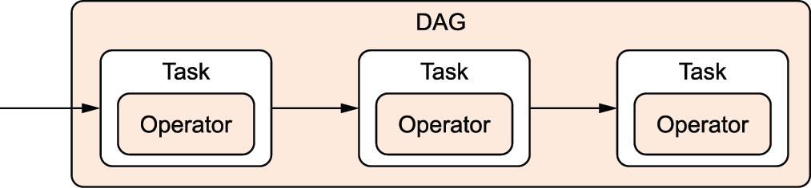{fig-align="center" width="60%"}

## Concepts $\leadsto$ Code {.crunch-title .crunch-ul data-name="Airflow Components+UI"}

``` {.bash filename="start-airflow.sh"}
airflow db migrate
airflow api-server --port 8080
airflow scheduler
airflow dag-processor
airflow triggerer
```

:::: {.columns}
::: {.column width="50%"}

* Full Airflow "ecosystem" is running once you've started each piece via above (`bash`) commands!
* Let's look at each in turn...

:::
::: {.column width="50%"}

{fig-align="center" width="400"}

:::
::::

## `db migrate`: The Airflow Metastore {.crunch-title}

``` {.bash filename="start-airflow.sh" code-line-numbers="1"}
airflow db migrate
airflow api-server --port 8080
airflow scheduler
airflow dag-processor
airflow triggerer
```

* General info used by DAGs: variables, connections, XComs
* Data about DAG and task runs (generated by scheduler)
* Logs / error information
* <i class='bi bi-exclamation-triangle' style='font-size: 90%;'></i> Not modified directly/manually! Managed by Airflow; To modify, use API Server &rarr;

## API Server {.crunch-title .crunch-quarto-figure}

``` {.bash filename="start-airflow.sh" code-line-numbers="2"}
airflow db migrate
airflow api-server --port 8080
airflow scheduler
airflow dag-processor
airflow triggerer
```

:::: {.columns}
::: {.column width="50%"}

Web UI for managing Airflow (much more on this later!)

::: {.callout-warning title="&nbsp;Default Login Info"}

Default `db migrate` generates **admin password** in `~/simple_auth_manager_passwords.json.generated`

:::

:::
::: {.column width="50%"}

{fig-align="center" width="85%"}

:::
::::

## `Scheduler` &rarr; `Executor` {.crunch-title}

:::: {.columns}
::: {.column width="50%"}

``` {.bash filename="start-airflow.sh" code-line-numbers="3"}
airflow db migrate
airflow api-server --port 8080
airflow scheduler
airflow dag-processor
airflow triggerer
```

* Default: `LocalExecutor`
* For scaling: `EcsExecutor` (AWS ECS), `KubernetesExecutor`
* See also [`SparkSubmitOperator`](https://airflow.apache.org/docs/apache-airflow-providers-apache-spark/stable/operators.html)

:::
::: {.column width="50%"}

{fig-align="center"}

:::
::::

## `DAG` Processor {.smaller}

``` {.bash filename="start-airflow.sh" code-line-numbers="4"}
airflow db migrate
airflow api-server --port 8080
airflow scheduler
airflow dag-processor
airflow triggerer
```

{fig-align="center"}

## The `schedule` Argument {.smaller .crunch-title .crunch-ul}

*(Airflow uses [`pendulum`](https://pendulum.eustace.io/) under the hood, rather than `datetime`!)*

``` {.python filename="dag_scheduling.py"}
from airflow.sdk import DAG
import pendulum
dag = DAG("regular_interval_cron_example", schedule="0 0 * * *", ...)
dag = DAG("regular_interval_cron_preset_example", schedule="@daily", ...)
dag = DAG("regular_interval_timedelta_example", schedule=pendulum.timedelta(days=1), ...)
```

[**`Cron`**](https://crontab.guru/): Full-on scheduling language (used by computers since [1975](https://en.wikipedia.org/wiki/Cron)!)

```bash {filename="crontab.sh"}
# ┌───────────── minute (0–59)
# │ ┌───────────── hour (0–23)
# │ │ ┌───────────── day of the month (1–31)
# │ │ │ ┌───────────── month (1–12)
# │ │ │ │ ┌───────────── day of the week (0–6) (Sunday to Saturday)
# │ │ │ │ │
# │ │ │ │ │
# │ │ │ │ │
# * * * * * <command to execute>
```

[Cron Presets](https://airflow.apache.org/docs/apache-airflow/stable/authoring-and-scheduling/cron.html#cron-presets): `None`, `"@once"`, `"@continuous"`, `"@hourly"`, `"@daily"`, `"@weekly"`

## External Service Integration {.smaller .crunch-title .crunch-ul}

| Service | Command |
| - | - |
| AWS | `pip install 'apache-airflow[amazon]'` |
| Azure | `pip install 'apache-airflow[microsoft-azure]'` |
| Databricks | `pip install 'apache-airflow[databricks]'` |
| GitHub | `pip install 'apache-airflow[github]'` |
| Google Cloud | `pip install 'apache-airflow[google]'` |
| MongoDB | `pip install 'apache-airflow[mongo]'` |
| OpenAI | `pip install 'apache-airflow[openai]'` |
| Slack | `pip install 'apache-airflow[slack]'` |
| Spark | `pip install 'apache-airflow[apache-spark]'` |
| Tableau | `pip install 'apache-airflow[tableau]'` |

*(And [many more](https://airflow.apache.org/docs/apache-airflow/stable/extra-packages-ref.html#external-services-extras):)*

## `Jinja` Example {.crunch-title .smaller .crunch-hr .crunch-ul}

:::: {layout="[48,4,48]" layout-valign="center"}
::: {.column width="48%"}

```html {filename="homepage.jinja"}
<h4>{{ me['name'] }}'s Favorite Hobbies</h4>
<ul>

  <li>{{ hobby }}</li>

</ul>
```

:::
::: {.column width="4%"}

<center>
\+
</center>

:::
::: {.column width="48%"}

```python {filename="render_jinja.py"}
from jinja2 import Template
tmpl = Template('homepage.jinja')
tmpl.render(
    me = {'name': 'Jeff'},
    hobbies = [
        'eat',
        'sleep',
        'attend to the proverbial bag'
    ]
)
```

:::
::::

<hr>

<center>
&darr;
</center>

<hr>

:::: {layout="[48,4,48]" layout-valign="center"}
::: {.column width="48%"}

```html {filename="rendered.html"}
<h4>Jeff's Favorite Hobbies</h4>
<ul>
  <li>eat</li>
  <li>sleep</li>
  <li>attend to the proverbial bag</li>
</ul>
```

:::
::: {.column width="4%"}

$\leadsto$

:::
::: {.column width="48%"}

```{=html}
<h4>Jeff's Favorite Hobbies</h4>
<ul>
  <li>eat</li>
  <li>sleep</li>
  <li>attend to the proverbial bag</li>
</ul>
```

:::
::::

## Airflow UI: Grid View

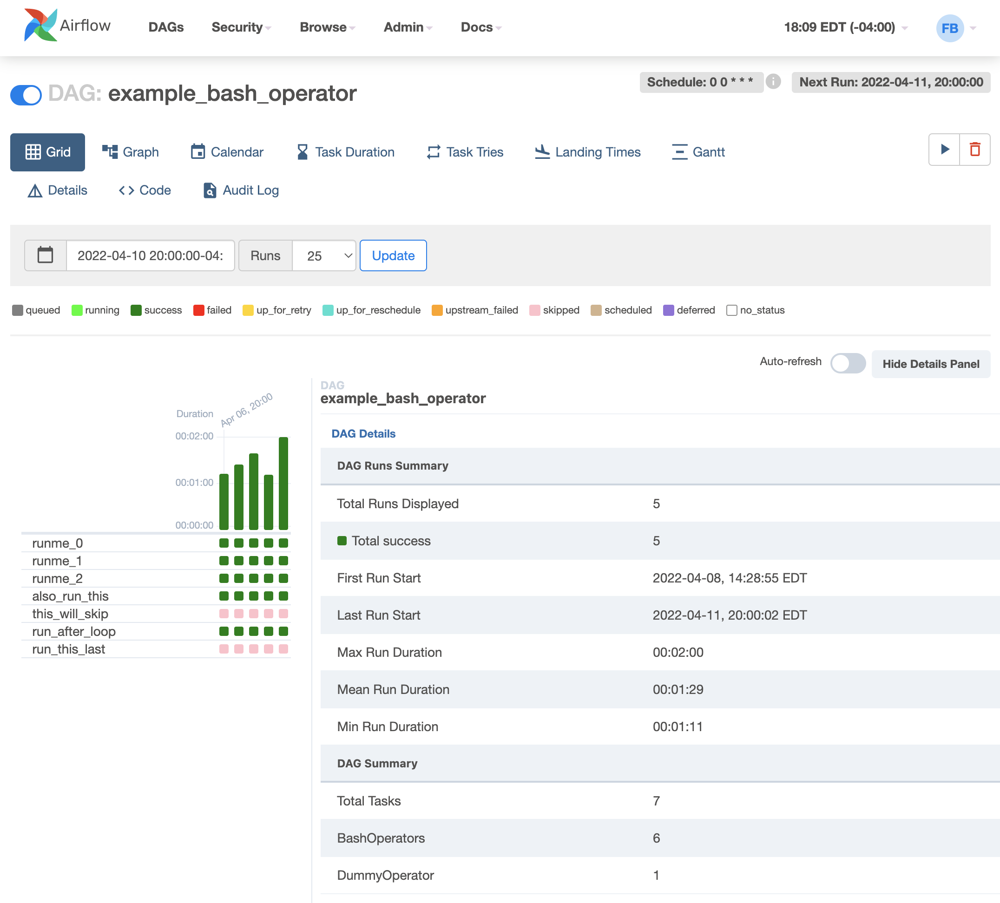{fig-align="center"}

## Airflow UI: Run Details

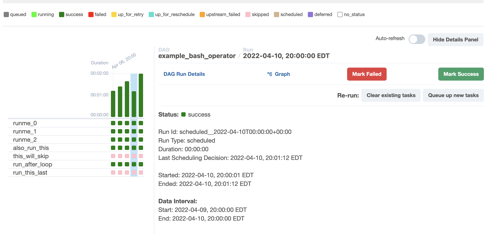{fig-align="center"}

## Airflow UI: Task Instance Details

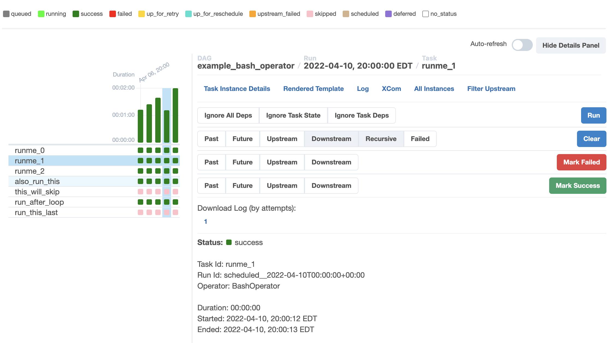{fig-align="center"}

## Tasks &rarr; Task Groups

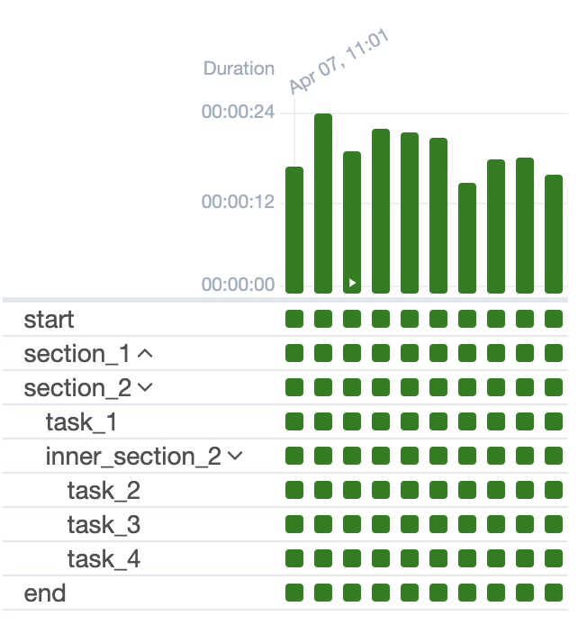{fig-align="center"}

## Graph View

{fig-align="center"}

## Calendar View

{fig-align="center"}

## Gantt View

{fig-align="center"}

## New Book: Up-To-Date (Airflow 3.0) Demos 🤓 {.smaller .title-10 .nostretch}

:::: {layout="[48,4,48]" layout-valign="center"}
::: {.column width="48%"}

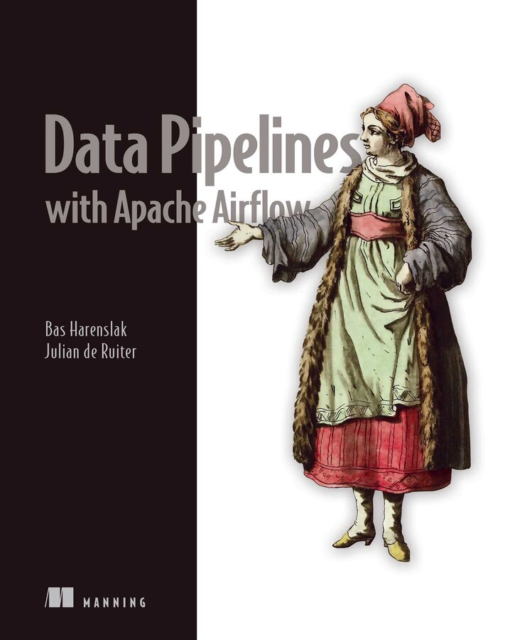{fig-align="center" width="380"}

:::
::: {.column width="4%"}

$\leadsto$

:::
::: {.column width="48%"}

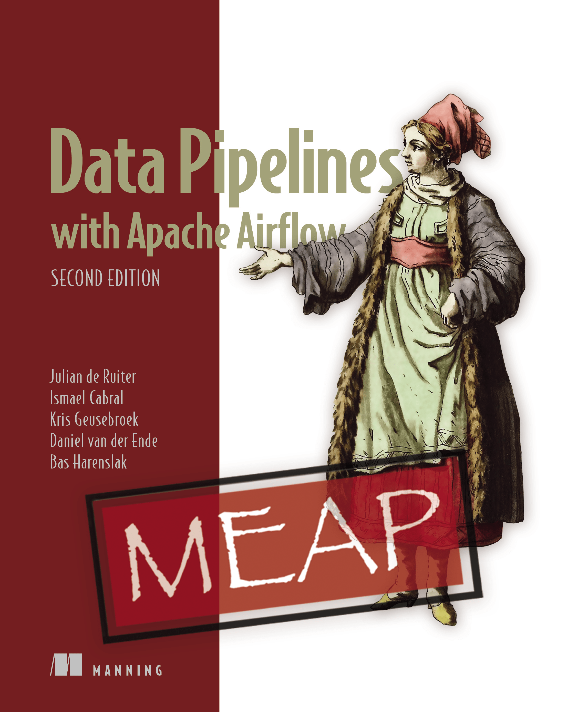{fig-align="center" width="380"}

:::
::::

## Conceptual Pipelines $\leadsto$ DAGs {.smaller}

Main challenge: converting "intuitive" pipelines in our heads:

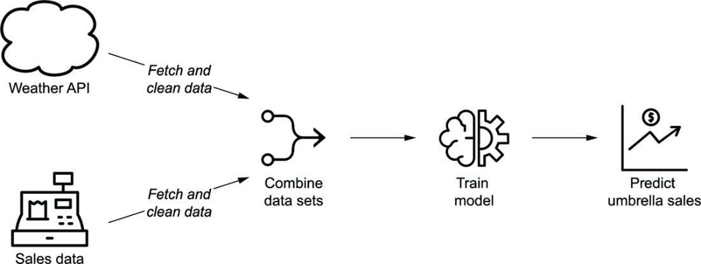{fig-align="center" width="60%"}

Into **`DAG`s** with concrete `Task`s, dependencies, and triggers:

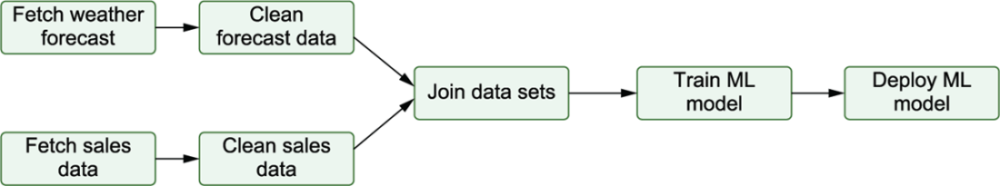{fig-align="center" width="60%"}

## Implementation Detail 1: Backfilling {.smaller .title-10}

{fig-align="center"}

## Implementation Detail 2: Train Model Only *After* Backfill {.smaller .title-09 .crunch-title .crunch-quarto-figure}

::::: {#fig-ml-deploy}

:::: {layout="[48,4,48]" layout-valign="center"}
::: {.column width="48%"}

{fig-align="center" width="400"}

:::
::: {.column width="4%"}

$\leadsto$

:::
::: {.column width="48%"}

{fig-align="center" width="400"}

[`LatestOnlyOperator`](https://airflow.apache.org/docs/apache-airflow-providers-standard/stable/_api/airflow/providers/standard/operators/latest_only/index.html#module-contents){.under}

:::
::::

Both figures from @ruiter_data_2026
:::::

## Implementation Detail 3: Downstream Consumers

{fig-align="center"}

## Lab Time! {data-name="Lab"}

[Lab 10: ETL Pipeline Orchestration with Airflow](https://classroom.github.com/classrooms/34950344-georgetown-university-dsan6000-big-data-and-cloud-computing)

# Vector Spaces: The Geometry of AI! {.not-title-slide .smaller .crunch-title .title-12 data-stack-name="Embeddings Overview"}

:::: {.columns}
::: {.column width="50%"}

](images/vector-space-query.jpeg){fig-align="center"}

:::
::: {.column width="50%"}

* Why **vector** spaces over **keyword** matching?
* What if words have different **meanings** in different **contexts**?

:::
::::

## Word Counts: Good Enough? {.smaller .crunch-title .title-12}

Just four keywords per section:

| Section | Keywords |
|------|-------|
| U.S. | `state`, `court`, `federal`, `republican` |
| World | `government`, `country`, `officials`, `minister` |
| Arts | `music`, `show`, `art`, `dance` |
| Sports | `game`, `league`, `team`, `coach` |
| Real Estate | `home`, `bedrooms`, `bathrooms`, `building` |

For each article, vote for section with highest keyword count:

| | Arts | Real Estate | Sports | U.S. News | World News | Total |
|-|------|-------------|--------|-----------|------------|------|
| Correct | 3020 | 690 | 4860 | 1330 | 1730 | **11630** |
| Incorrect | 750 | 60 | 370 | 1100 | 590 | **2870** |
| Accuracy | **0.801** | **0.920** | **0.929** | <span class="redbox">**0.547**</span> | <span class="redbox">**0.746**</span> | **0.802** |

## What's Missing? Context! {.crunch-title}

::: {.callout-note appearance="minimal"}

*You shall know a word by the company it keeps.* [@firth_papers_1957]

:::

:::: {.columns style="font-size: 75%;"}
::: {.column width="50%"}

<center>

**Article A** (World News):

</center>

<!-- President Vladimir V. Putin told Russia's natural gas monopoly, Gazprom, on Saturday to continue selling subsidized gas to Ukraine until the end of March if Ukraine agrees to pay market prices beginning in April. Mr. Putin's order, delivered on national television as Gazprom threatened to cut off gas exports for Ukraine beginning on Jan. 1, put Russia's president in the center of a dispute that has caused Europe to worry whether its gas supply will be disrupted in the January chill. Ukraine replied warily. The office of President Viktor A. Yushchenko noted that ''negotiations of the settlement of the gas problem have crossed into a new phase.'' A spokesman for Yury I. Yekhanurov, Ukraine's prime minister, was quoted by Interfax saying that Ukraine agreed to a transition to market prices, but the details require negotiations. Mr. Putin gave Ukraine until midnight Saturday to accept his terms. -->

**President Bush** said he was trying to convince **President Vladimir Putin** of Russia that cooperation was "in Russia's security interests," even though Defense Secretary Robert M. Gates did not win Mr. Putin's support during a trip to Moscow last week.

["Bush Steps Up Effort to Persuade Putin on Missile Defense Plan"](https://www.nytimes.com/2007/05/01/world/europe/01prexy.html), *NYTimes*, 1 May 2007.

:::
::: {.column width="50%"}

<center>

**Article B** (U.S. News):

</center>

**President Bush** began his day yesterday at dawn on the **golf** course. He began Saturday on the golf course, too. A weekend earlier, the president played two rounds of 18 holes on the course at Andrews Air Force Base just outside Washington.

["White House Letter; Bush Makes Quick Work of Relaxing"](https://www.nytimes.com/2002/08/05/us/white-house-letter-bush-makes-quick-work-of-relaxing.html), *NYTimes*, 5 August 2002.

:::
::::


## Basic Context Engineering {.smaller .text-65 .crunch-title .inline-90 .crunch-ul .crunch-li-8}

* What exactly do we mean when we say **"context"**?
* Different **training objectives** give different types of contexts!
* Example: Closest vectors to **Turing**, trained on Wikipedia in two ways:

<br>

<table>
<thead>
<tr>
<th></th>
<th class="bb" width="25%">Dependency Tree</th>
<th>5-Word Window</th>
<th></th>
</tr>
</thead>
<tbody>
<tr>
<td class="bb tb">Same category $\rightarrow$</td>
<td class="ln tb bn">Pauling</td>
<td class="rn bn lb">nondeterministic</td>
<td class="bb">$\leftarrow$ Topically related</td>
</tr>
<tr>
<td class="bn tdc">*(Paradigmatic)*</td>
<td class="lb bn">Hotelling</td>
<td class="rb bn">computability</td>
<td class="bn tdc">*(Syntagmatic)*</td>
</tr>
<tr>
<td class="bn"></td>
<td class="lb bn">Lessing</td>
<td class="rb bn">deterministic</td>
<td class="bn"></td>
</tr>
<tr>
<td></td>
<td class="lb bb">Hamming</td>
<td class="rb bb">finite-state</td>
<td class="bn"></td>
</tr>
</tbody>
<caption style='text-align: center; font-size: 90%;'>Example from Uber AI Labs' amazing [Piero Molina](https://w4nderlu.st/teaching/word-embeddings)</caption>
</table>

## Pretentious But Helpful Terms! {.smaller .crunch-title}

* **Paradigmatic** $\approx$ Grammatical "substitutes", drawn from same category/type
* **Syntagmatic** $\approx$ semantic relationships between words in a sentence

<br>

<style>
.top-cb1 {
  border-top: 3px solid #e69f00 !important;
}
.left-cb1 {
  border-left: 3px solid #e69f00 !important;
}
.right-cb1 {
  border-right: 3px solid #e69f00 !important;
}
.bottom-cb1 {
  border-bottom: 3px solid #e69f00 !important;
}
.top-cb2 {
  border-top: 3px solid #56b4e0 !important;
}
.left-cb2 {
  border-left: 3px solid #56b4e0 !important;
}
.right-cb2 {
  border-right: 3px solid #56b4e0 !important;
}
.bottom-cb2 {
  border-bottom: 3px solid #56b4e0 !important;
}
.bg-mix {
  background-color: #9EAA7550 !important;
}
.top-mix {
  border-top: 3px solid #9EAA7590 !important;
}
.bottom-mix {
  border-bottom: 3px solid #9EAA7590 !important;
}
.left-mix {
  border-left: 3px solid #9EAA7590 !important;
}
.right-mix {
  border-right: 3px solid #9EAA7590 !important;
}
.top-none {
  border-top: 0px solid white !important;
}
.bottom-none {
  border-bottom: 0px solid white !important;
}
.right-none {
  border-right: 0px solid white !important;
}
.left-none {
  border-left: 0px solid white !important;
}
</style>

<table>
<thead>
<tr>
  <th class='bottom-none'></th>
  <th class='top-cb2 left-cb2 right-cb2 cb2a-bg' align="center">Paradigmatic<br>&darr;</th>
  <th class='bottom-none'></th>
  <th class='top-cb2 left-cb2 right-cb2 cb2a-bg' align="center">Paradigmatic<br>&darr;</th>
  <th class='bottom-none'></th>
</tr>
</thead>
<tbody>
<tr>
  <td class='top-none bottom-none'></td>
  <td class='tdc bg-mix top-cb1 left-cb1 bottom-cb1 right-mix'>`apples`</td>
  <td class='tdc cb1a-bg top-cb1 bottom-cb1 right-none left-mix'>&larr; **Syntagmatic** &rarr;</td>
  <td class='tdc bg-mix top-cb1 right-cb1 bottom-cb1 left-mix'>`sweet`</td>
  <td class='bottom-none'></td>
</tr>
<tr>
  <td class='top-none'></td>
  <td class='tdc bg-mix left-cb1 bottom-cb1 top-cb1 right-mix'>`oranges`</td>
  <td class='tdc cb1a-bg top-cb1 bottom-cb1 right-none left-none'>&larr; **Syntagmatic** &rarr;</td>
  <td class='tdc bg-mix top-cb1 right-cb1 bottom-cb1 left-mix'>`sour`</td>
  <td></td>
</tr>
<tr>
  <td class='tdc' style='font-size: 150%;'>These</td>
  <td class='tdc left-cb2 right-cb2 bottom-cb2' style='font-size: 150%;'>$\underline{\hspace{32mm}}$</td>
  <td class='tdc' style='font-size: 150%;'>taste very</td>
  <td class='tdc left-cb2 right-cb2 bottom-cb2' style='font-size: 150%;'>$\underline{\hspace{32mm}}$</td>
  <td class='tdc' style='font-size: 150%;'>!</td>
</tr>
</tbody>
<caption style='font-size: 90%; text-align: center;'><br>*(Both terms from @saussure_course_1916)*</caption>
</table>


## How Do We Actually *Get* These Vectors? {.smaller .crunch-title .crunch-ul .title-11 .inline-90}

::: {.r-stretch}

{fig-align="center"}

:::

* *High-level goal*: **Retain** information about **word-context relationships** while **reducing** the $M$-dimensional representations of each word down to 3 dimensions.
* *Low-level goal*: Generate **rank-$K$** matrix $\mathbf{W}$ which **best approximates** distances between words in $M$-dimensional space (rows in $\mathbf{X}$)

# Now We Put These Embeddings (Vectors) into *Databases* {data-stack-name="Vector Databases"}

* The goal: identify **similar** object as vectors "close to" the location (in vector space) of a given **query**

## Vector Search Workflow

](images/vector_search.png){fig-align="center"}

## Unstructured Data $\leadsto$ Structured Geometric Query Space {.smaller .crunch-title .crunch-img}

::: {#fig-embed-images}

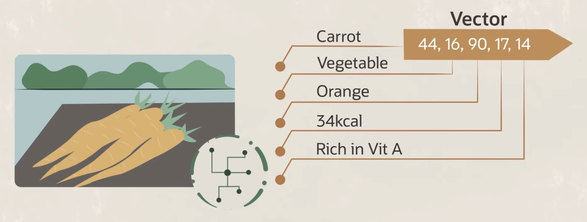{fig-align="center" width="60%"}

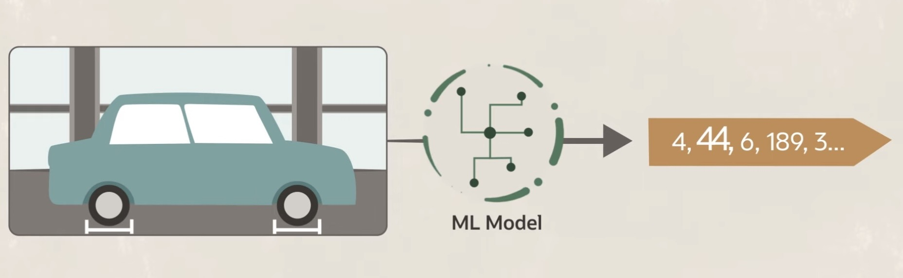{fig-align="center" width="60%"}

[Image Source](https://www.youtube.com/watch?v=ebMkbWzFCnA&t=80s)
:::

## More Data $\leadsto$ "Increasing Returns" {.smaller .crunch-title .crunch-img .crunch-quarto-figure}

:::: {layout="[[1,1],[1]]" layout-valign="center"}

::: {.cap-right}

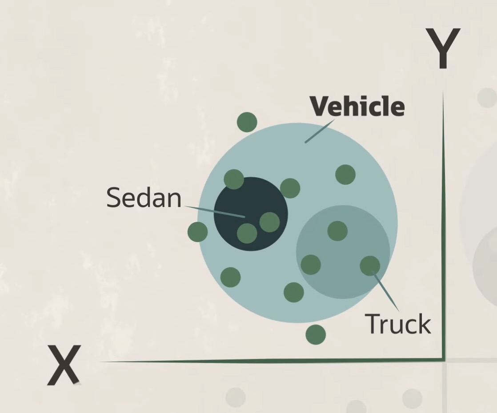{fig-align="right" width="260"}

:::

::: {.cap-left}

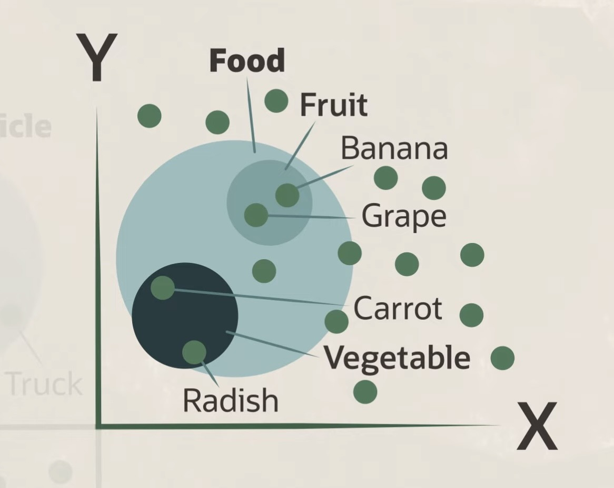{fig-align="left" width="274"}

:::

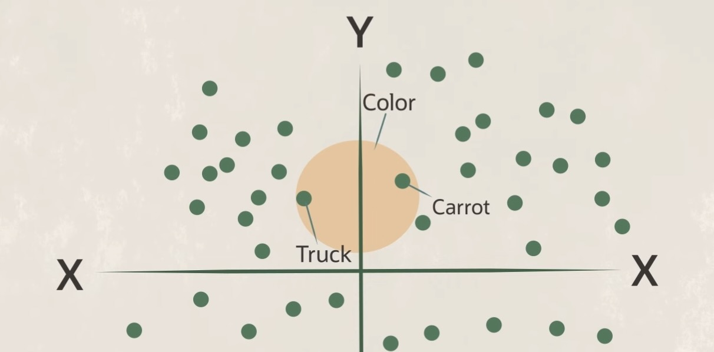{fig-align="center" width="570"}

::::

## Queries Embedded via the *Same* Model! {.smaller .crunch-title .title-11}

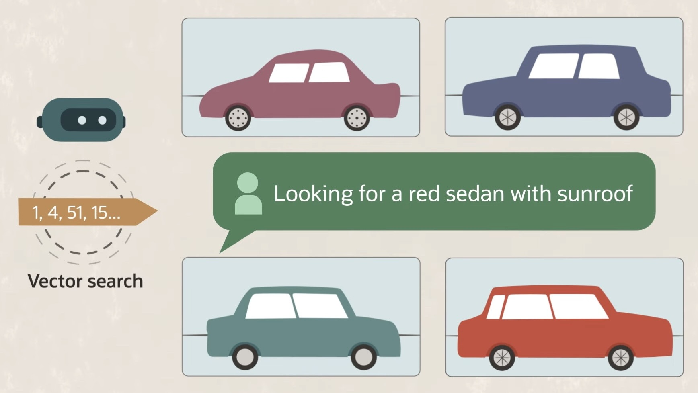{fig-align="center"}

# Lab Time! {data-stack-name="Lab 11"}

* Lab 11 on [Canvas](https://georgetown.instructure.com/courses/213755/assignments/1280778)
* Lab 11 on [GitHub Classroom](https://classroom.github.com/a/Ek1Auxq3)

## References

::: {#refs}
:::


## References

::: {#refs}
:::
