::: {.content-visible unless-format="revealjs"}

<center class='mb-3'>
<a class="h2" href="./slides.html" target="_blank">Open slides in new tab &rarr;</a>
</center>

:::

## Concepts $\leadsto$ Code {.crunch-title .crunch-ul data-name="Airflow Components+UI"}

``` {.bash filename="start-airflow.sh"}
airflow db migrate
airflow api-server --port 8080
airflow scheduler
airflow dag-processor
airflow triggerer
```

:::: {.columns}
::: {.column width="50%"}

* Full Airflow "ecosystem" is running once you've started each piece via above (`bash`) commands!
* Let's look at each in turn...

:::
::: {.column width="50%"}

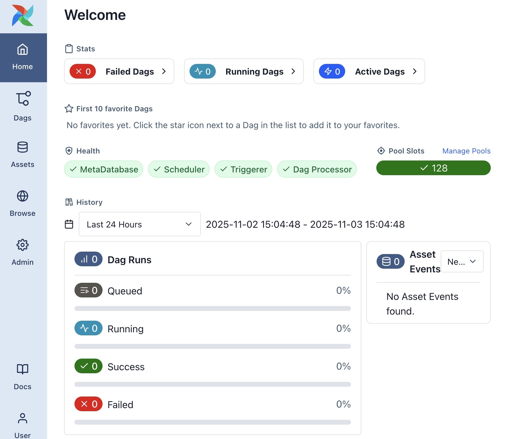{fig-align="center" width="400"}

:::
::::

## `db migrate`: The Airflow Metastore {.crunch-title}

``` {.bash filename="start-airflow.sh" code-line-numbers="1"}
airflow db migrate
airflow api-server --port 8080
airflow scheduler
airflow dag-processor
airflow triggerer
```

* General info used by DAGs: variables, connections, XComs
* Data about DAG and task runs (generated by scheduler)
* Logs / error information
* <i class='bi bi-exclamation-triangle' style='font-size: 90%;'></i> Not modified directly/manually! Managed by Airflow; To modify, use API Server &rarr;

## API Server {.crunch-title .crunch-quarto-figure}

``` {.bash filename="start-airflow.sh" code-line-numbers="2"}
airflow db migrate
airflow api-server --port 8080
airflow scheduler
airflow dag-processor
airflow triggerer
```

:::: {.columns}
::: {.column width="50%"}

Web UI for managing Airflow (much more on this later!)

::: {.callout-warning title="&nbsp;Default Login Info"}

Default `db migrate` generates **admin password** in `~/simple_auth_manager_passwords.json.generated`

:::

:::
::: {.column width="50%"}

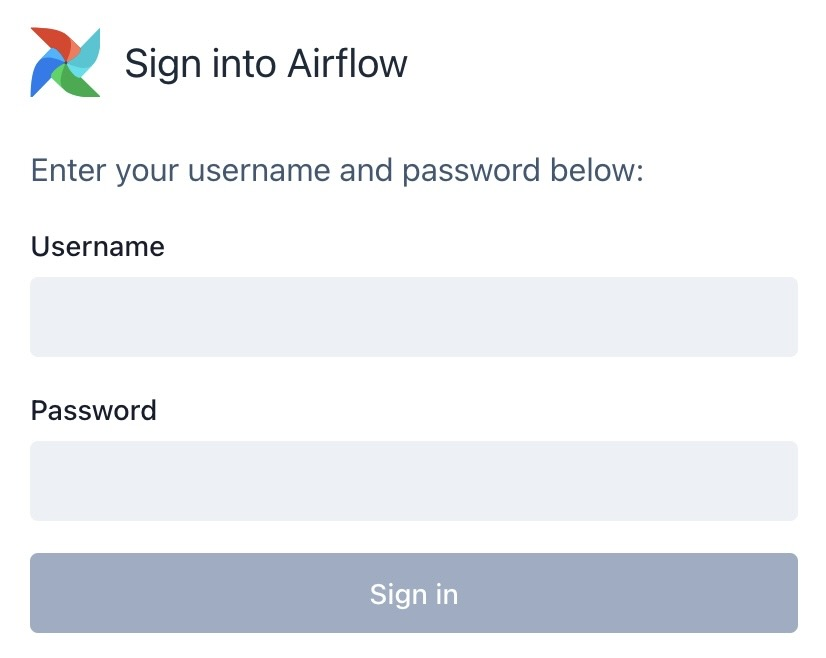{fig-align="center" width="85%"}

:::
::::

## `Scheduler` &rarr; `Executor` {.crunch-title}

:::: {.columns}
::: {.column width="50%"}

``` {.bash filename="start-airflow.sh" code-line-numbers="3"}
airflow db migrate
airflow api-server --port 8080
airflow scheduler
airflow dag-processor
airflow triggerer
```

* Default: `LocalExecutor`
* For scaling: `EcsExecutor` (AWS ECS), `KubernetesExecutor`
* See also [`SparkSubmitOperator`](https://airflow.apache.org/docs/apache-airflow-providers-apache-spark/stable/operators.html)

:::
::: {.column width="50%"}

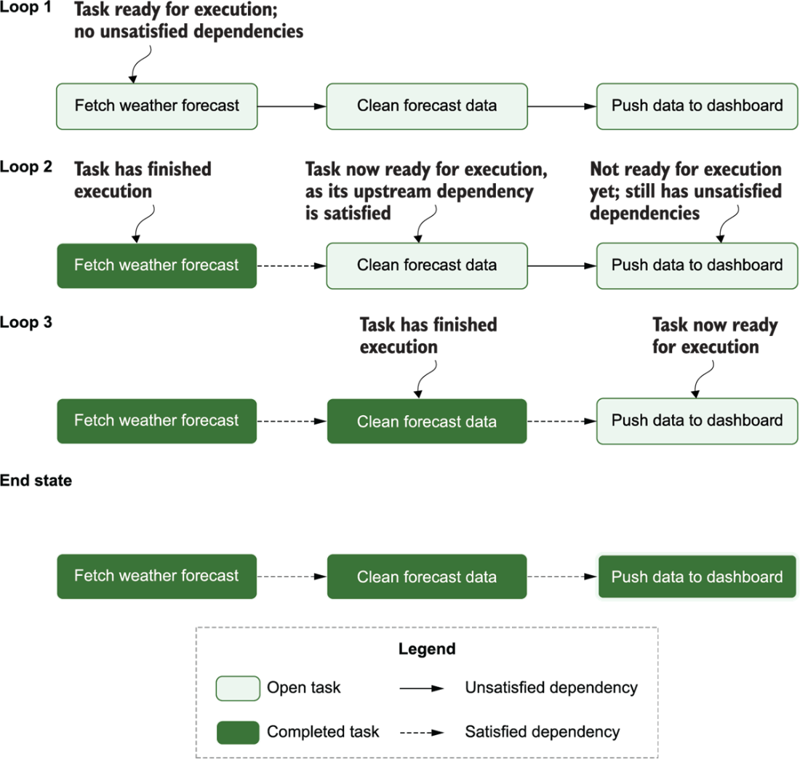{fig-align="center"}

:::
::::

## `DAG` Processor {.smaller}

``` {.bash filename="start-airflow.sh" code-line-numbers="4"}
airflow db migrate
airflow api-server --port 8080
airflow scheduler
airflow dag-processor
airflow triggerer
```

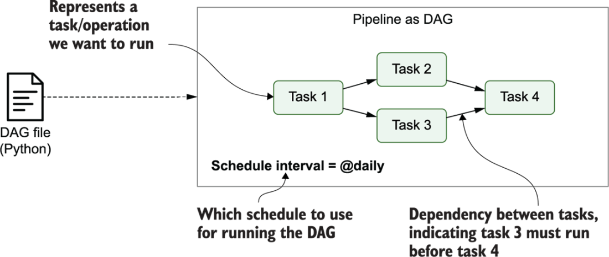{fig-align="center"}

## The `schedule` Argument {.smaller .crunch-title .crunch-ul}

*(Airflow uses [`pendulum`](https://pendulum.eustace.io/) under the hood, rather than `datetime`!)*

``` {.python filename="dag_scheduling.py"}
from airflow.sdk import DAG
import pendulum
dag = DAG("regular_interval_cron_example", schedule="0 0 * * *", ...)
dag = DAG("regular_interval_cron_preset_example", schedule="@daily", ...)
dag = DAG("regular_interval_timedelta_example", schedule=pendulum.timedelta(days=1), ...)
```

[**`Cron`**](https://crontab.guru/): Full-on scheduling language (used by computers since [1975](https://en.wikipedia.org/wiki/Cron)!)

```bash {filename="crontab.sh"}
# ┌───────────── minute (0–59)
# │ ┌───────────── hour (0–23)
# │ │ ┌───────────── day of the month (1–31)
# │ │ │ ┌───────────── month (1–12)
# │ │ │ │ ┌───────────── day of the week (0–6) (Sunday to Saturday)
# │ │ │ │ │
# │ │ │ │ │
# │ │ │ │ │
# * * * * * <command to execute>
```

[Cron Presets](https://airflow.apache.org/docs/apache-airflow/stable/authoring-and-scheduling/cron.html#cron-presets): `None`, `"@once"`, `"@continuous"`, `"@hourly"`, `"@daily"`, `"@weekly"`

## External Service Integration {.smaller .crunch-title .crunch-ul}

| Service | Command |
| - | - |
| AWS | `pip install 'apache-airflow[amazon]'` |
| Azure | `pip install 'apache-airflow[microsoft-azure]'` |
| Databricks | `pip install 'apache-airflow[databricks]'` |
| GitHub | `pip install 'apache-airflow[github]'` |
| Google Cloud | `pip install 'apache-airflow[google]'` |
| MongoDB | `pip install 'apache-airflow[mongo]'` |
| OpenAI | `pip install 'apache-airflow[openai]'` |
| Slack | `pip install 'apache-airflow[slack]'` |
| Spark | `pip install 'apache-airflow[apache-spark]'` |
| Tableau | `pip install 'apache-airflow[tableau]'` |

*(And [many more](https://airflow.apache.org/docs/apache-airflow/stable/extra-packages-ref.html#external-services-extras):)*

## `Jinja` Example {.crunch-title .smaller .crunch-hr .crunch-ul}

:::: {layout="[48,4,48]" layout-valign="center"}
::: {.column width="48%"}

```html {filename="homepage.jinja"}
<h4>{{ me['name'] }}'s Favorite Hobbies</h4>
<ul>

  <li>{{ hobby }}</li>

</ul>
```

:::
::: {.column width="4%"}

<center>
\+
</center>

:::
::: {.column width="48%"}

```python {filename="render_jinja.py"}
from jinja2 import Template
tmpl = Template('homepage.jinja')
tmpl.render(
    me = {'name': 'Jeff'},
    hobbies = [
        'eat',
        'sleep',
        'attend to the proverbial bag'
    ]
)
```

:::
::::

<hr>

<center>
&darr;
</center>

<hr>

:::: {layout="[48,4,48]" layout-valign="center"}
::: {.column width="48%"}

```html {filename="rendered.html"}
<h4>Jeff's Favorite Hobbies</h4>
<ul>
  <li>eat</li>
  <li>sleep</li>
  <li>attend to the proverbial bag</li>
</ul>
```

:::
::: {.column width="4%"}

$\leadsto$

:::
::: {.column width="48%"}

```{=html}
<h4>Jeff's Favorite Hobbies</h4>
<ul>
  <li>eat</li>
  <li>sleep</li>
  <li>attend to the proverbial bag</li>
</ul>
```

:::
::::

## Airflow UI: Grid View

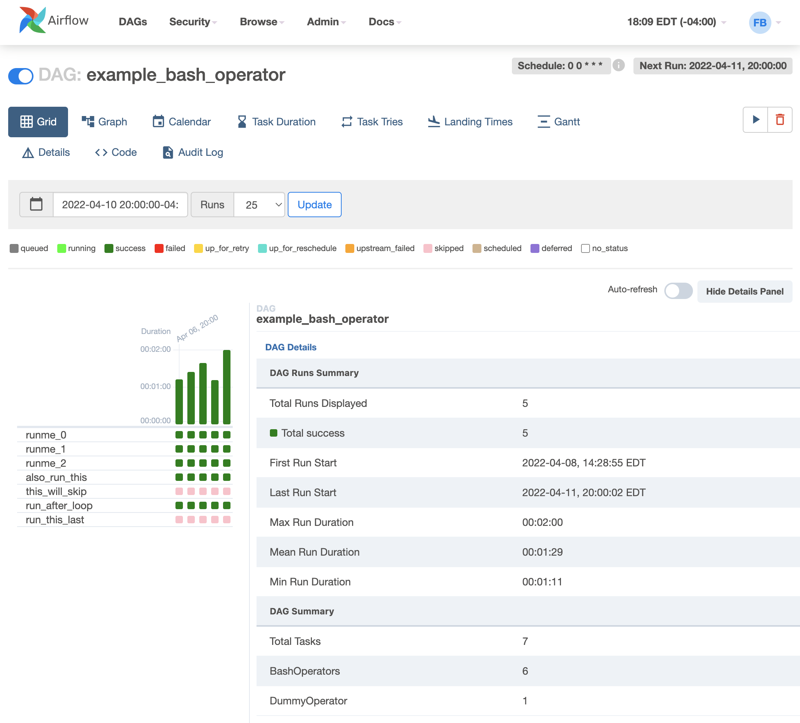{fig-align="center"}

## Airflow UI: Run Details

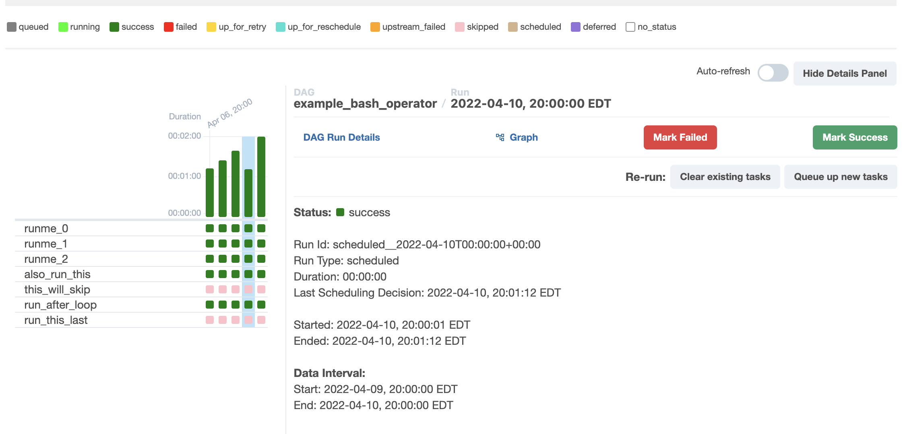{fig-align="center"}

## Airflow UI: Task Instance Details

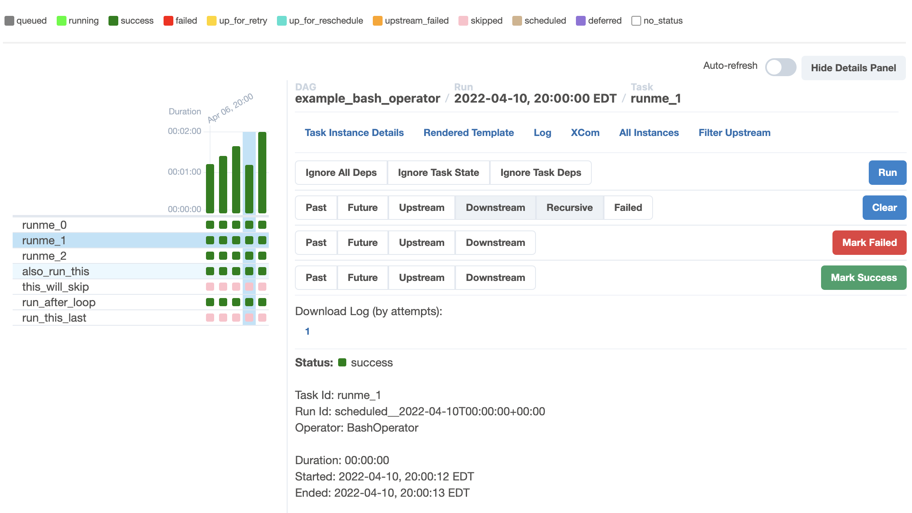{fig-align="center"}

## Tasks &rarr; Task Groups

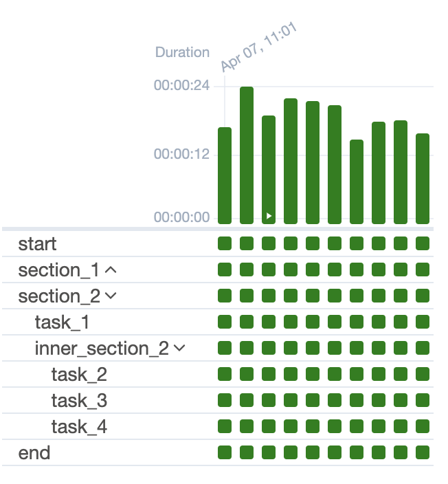{fig-align="center"}

## Graph View

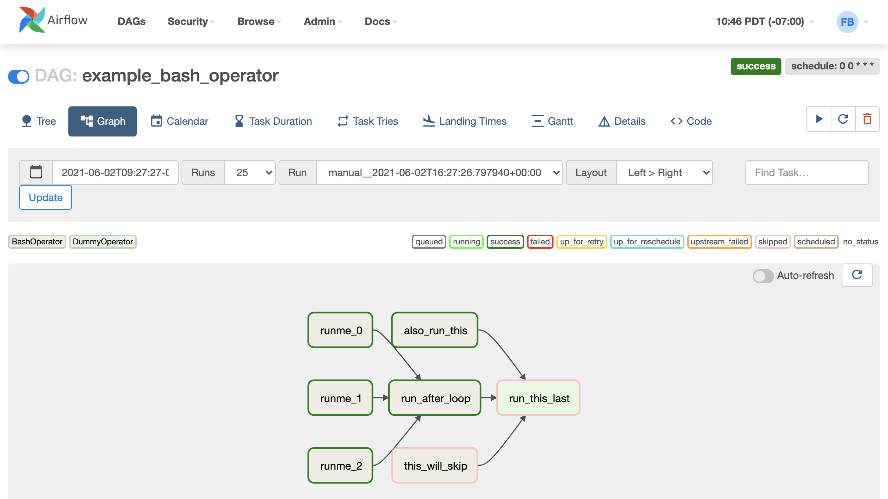{fig-align="center"}

## Calendar View

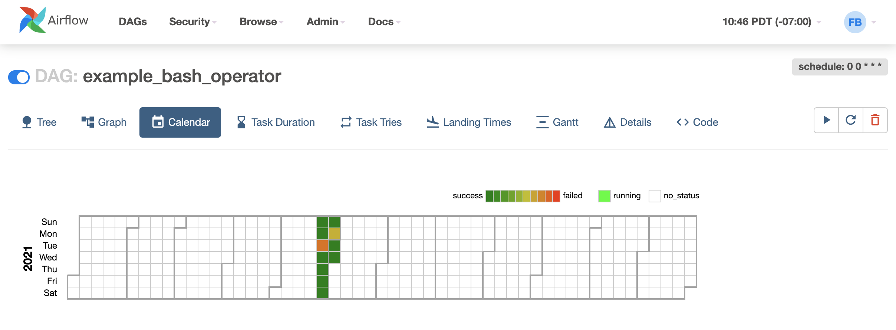{fig-align="center"}

## Gantt View

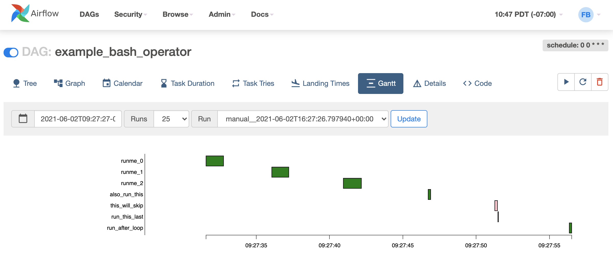{fig-align="center"}

## New Book: Up-To-Date (Airflow 3.0) Demos 🤓 {.smaller .title-10 .nostretch}

:::: {layout="[48,4,48]" layout-valign="center"}
::: {.column width="48%"}

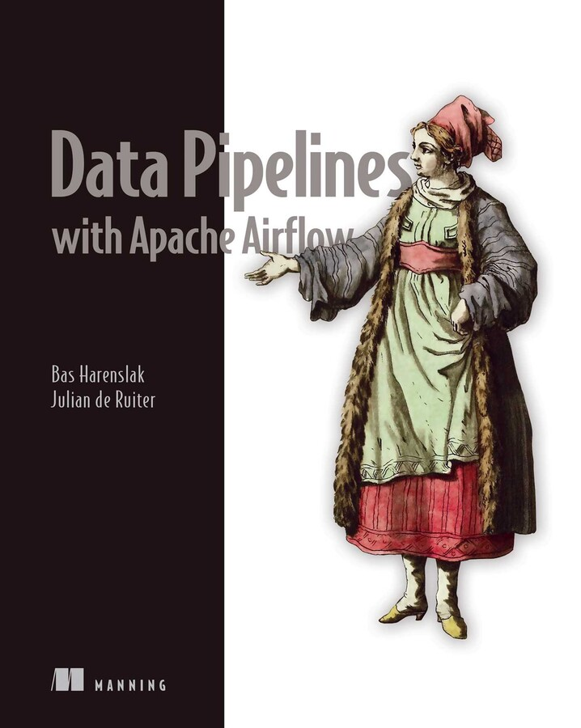{fig-align="center" width="380"}

:::
::: {.column width="4%"}

$\leadsto$

:::
::: {.column width="48%"}

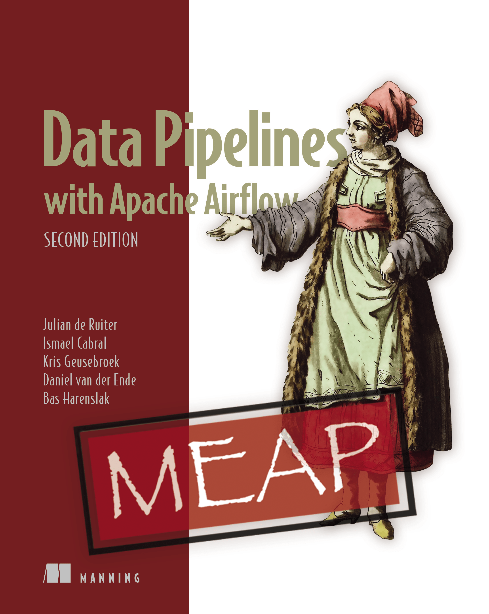{fig-align="center" width="380"}

:::
::::

## Conceptual Pipelines $\leadsto$ DAGs {.smaller}

Main challenge: converting "intuitive" pipelines in our heads:

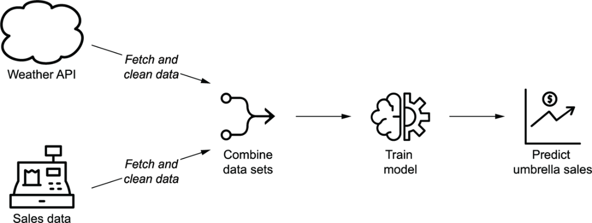{fig-align="center" width="60%"}

Into **`DAG`s** with concrete `Task`s, dependencies, and triggers:

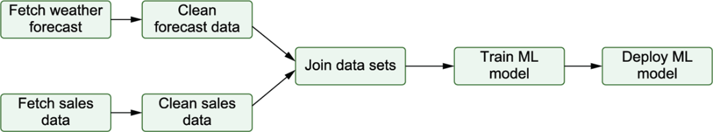{fig-align="center" width="60%"}

## Implementation Detail 1: Backfilling {.smaller .title-10}

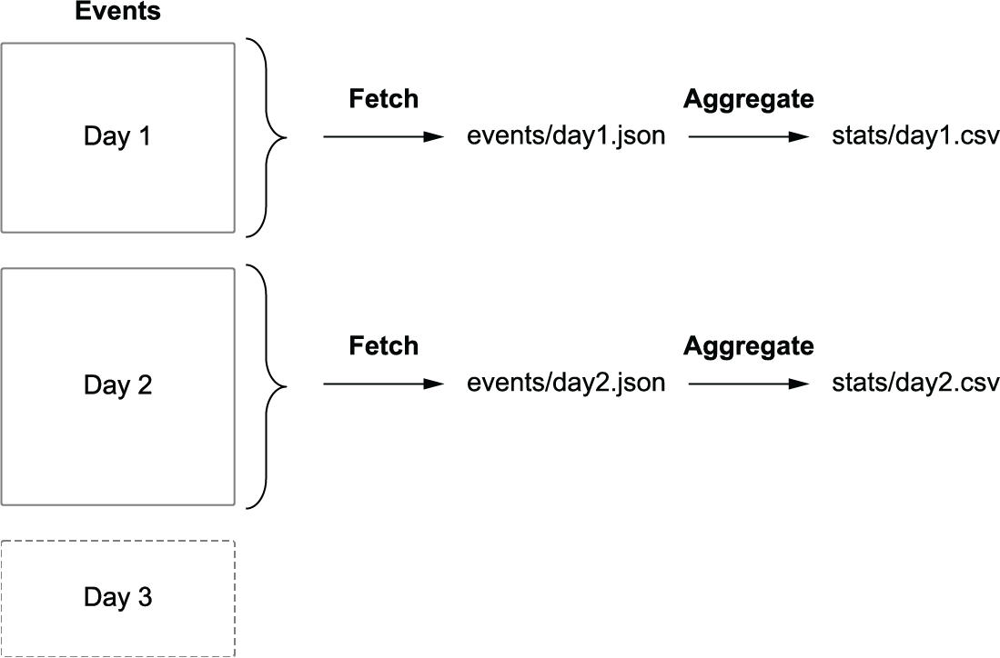{fig-align="center"}

## Implementation Detail 2: Train Model Only *After* Backfill {.smaller .title-09 .crunch-title .crunch-quarto-figure}

::::: {#fig-ml-deploy}

:::: {layout="[48,4,48]" layout-valign="center"}
::: {.column width="48%"}

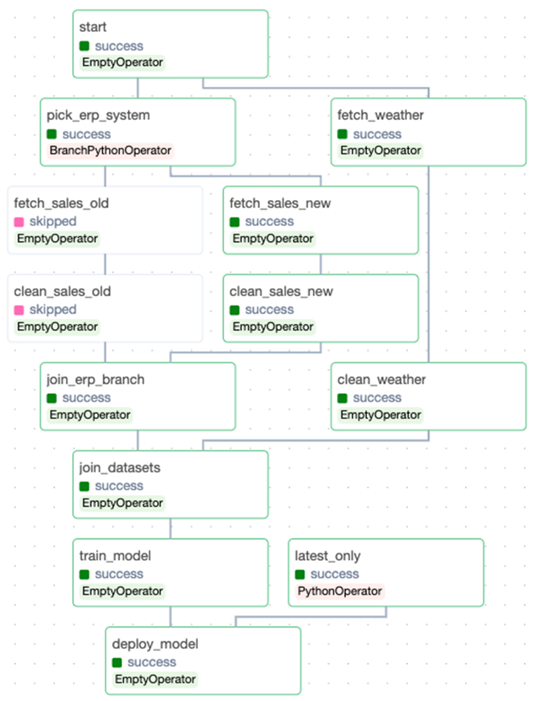{fig-align="center" width="400"}

:::
::: {.column width="4%"}

$\leadsto$

:::
::: {.column width="48%"}

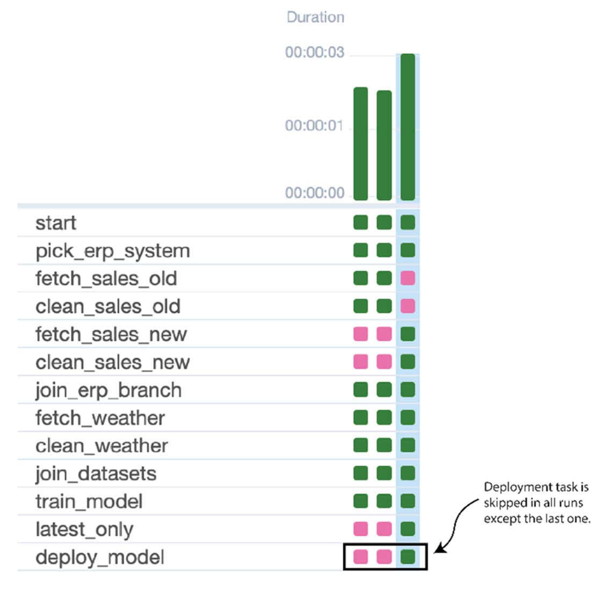{fig-align="center" width="400"}

[`LatestOnlyOperator`](https://airflow.apache.org/docs/apache-airflow-providers-standard/stable/_api/airflow/providers/standard/operators/latest_only/index.html#module-contents){.under}

:::
::::

Both figures from @ruiter_data_2026
:::::

## Implementation Detail 3: Downstream Consumers

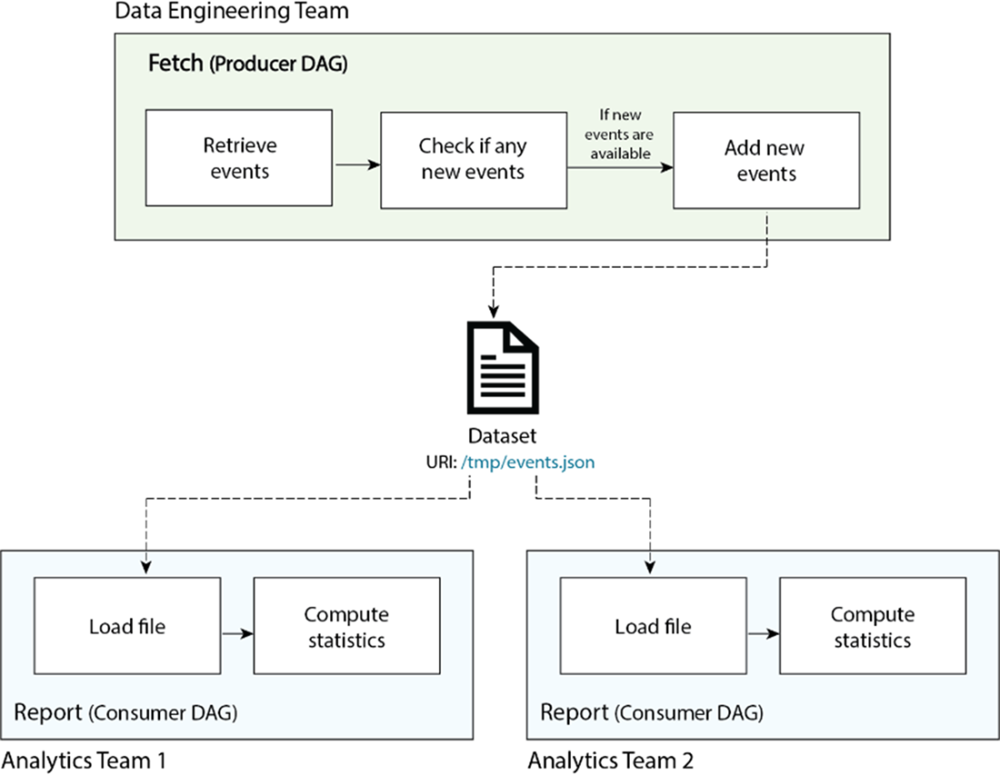{fig-align="center"}

## References

::: {#refs}
:::
