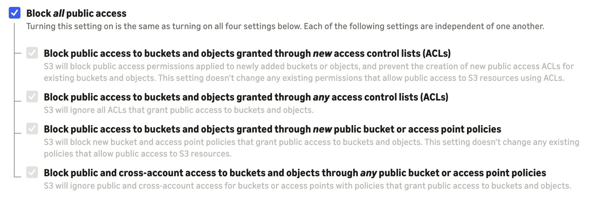
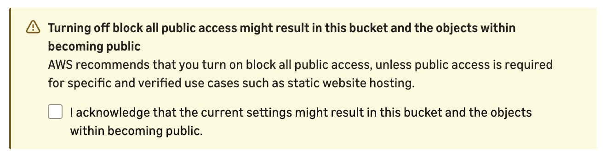
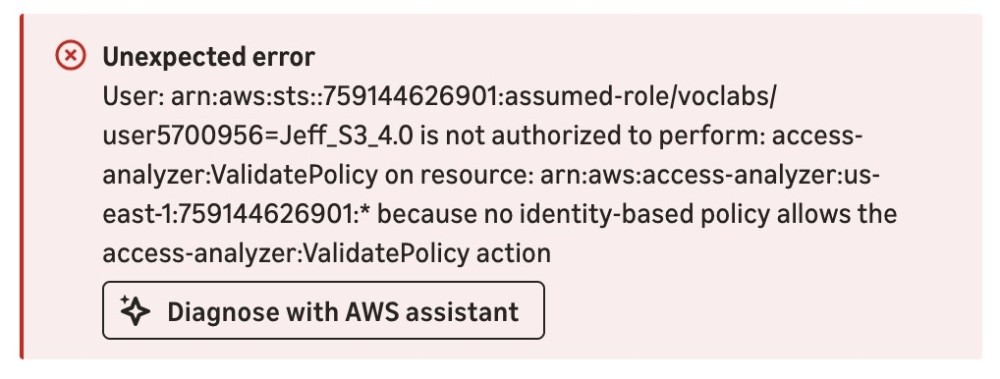
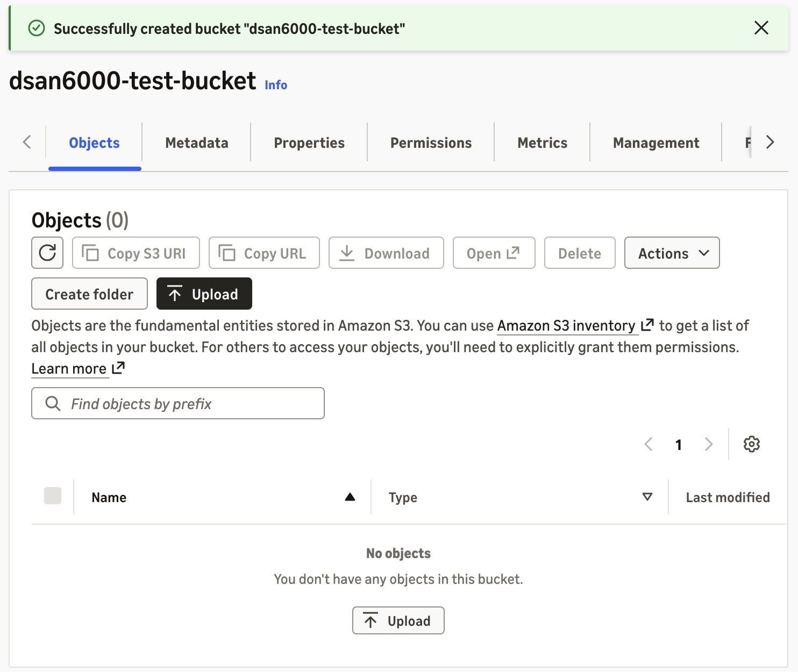
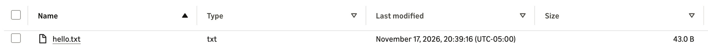
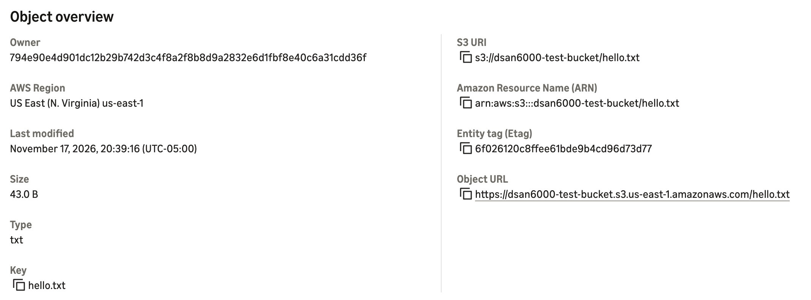
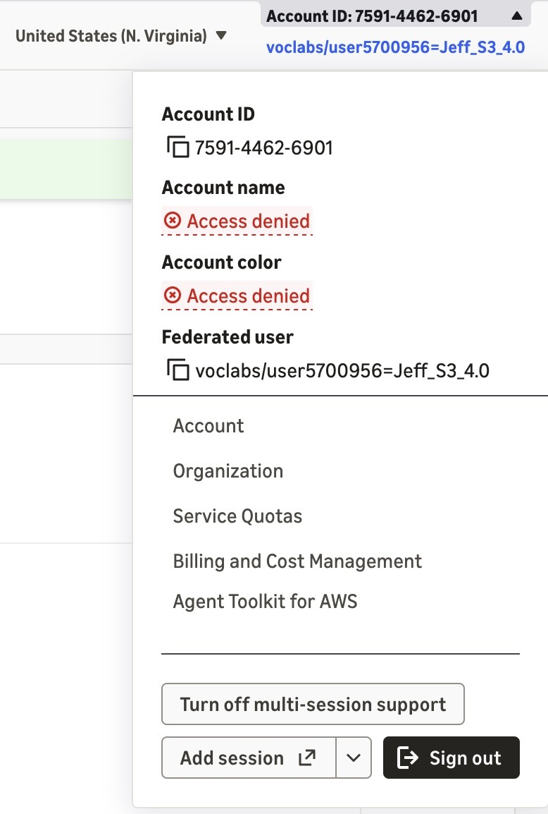

If you are bumping up against the fact that

(a) Having an S3 bucket shared across groupmates is tricky (relative to, a personal bucket or a totally-publicly-accessible bucket), and
(b) It is made even tricker by AWS's restrictions on creating IAM roles for students with $50 AWS Academy accounts...

You are not alone! This writeup will address how to create and share data among members of a final project group.

## (1) Creating a Publicly-Accessible Bucket

### (1.1) The Bucket-Creation Wizard

Before even processing your chosen dataset, we recommend that you ingest it into a **publicly-accessible** S3 bucket that all members of the group can use from now until the end of the semester.

To **create** this publicly-accessible bucket in the first place, you'll need to uncheck the "Block *all* public access" checkbox during the bucket creation wizard:

{.lightbox fig-align="center" width="100%"}

Then you will need to acknowledge their warning that... publicly-accessible buckets are publicly-accessible:

{.lightbox fig-align="center" width="80%"}

Keep in mind, also, that the bucket **name** needs to be **globally** unique: in the same way that domain names like `https://google.com` can already be taken (so that you can't go register `google.com`), S3 bucket URIs like `s3://my-cool-bucket` can also be taken, so that you'll need to make sure that your S3 bucket name is unique.

### (1.2) Updating the Bucket's Access Policy

Once the bucket has been created, you can navigate to the page for a bucket you've created in the AWS Console, click the "Permissions" tab then click the "Edit" button within the Bucket Policy panel, and paste the following code in as the bucket's new access policy:

``` {.json}
{
    "Version": "2012-10-17",
    "Statement": [
        {
            "Sid": "PublicReadGetObject",
            "Effect": "Allow",
            "Principal": "*",
            "Action": "s3:GetObject",
            "Resource": "arn:aws:s3:::dsan6000-hrsl/*"
        },
        {
            "Sid": "PublicListBucket",
            "Effect": "Allow",
            "Principal": "*",
            "Action": "s3:ListBucket",
            "Resource": "arn:aws:s3:::dsan6000-hrsl"
        }
    ]
}
```

Please note that:


(a) This is the policy for the `dsan6000-hrsl` bucket used for HW6, so, **everywhere you see `dsan6000-hrsl` there, please change it to the name of *your* bucket**. And,
(b) You will see a **red-background error message** at the bottom of the edit policy page that looks as follows:
    {.lightbox fig-align="center"}
    This is actually completely ok, and expected! It is just saying that (for whatever reason) the $50 student AWS accounts block the ability to click a "Validate Policy" button. But, you will still be able to click the **"Save Changes" button** at the bottom of this page.

Files added to your bucket will now be accessible to all, including the members of your group! As a final "sanity check", you can click the "<i class='bi bi-upload'></i> Upload" button near the bottom of the bucket's page in the AWS Console, then upload a test file like [this `hello.txt` file](assets/hello.txt){.external target='_blank'} ( to save it locally):

{.lightbox fig-align="center"}

Once you have uploaded the file, you can click on the filename within the new bucket contents listing:

{.lightbox fig-align="center"}

And, in the file details page that then opens, you should see an **Object URL** listing (in the bottom-right of this screenshot):

{.lightbox fig-align="center"}

Copy that object URL (`https://dsan6000-test-bucket.s3.us-east-1.amazonaws.com/hello.txt`), in the case of the above screenshot, and have a group member try opening it in their browser (or just open it yourself within an **Incognito**/**Private Browsing** tab). If the contents are visible, this means that files within the bucket are indeed publicly-accessible!

## (2) Ingesting Data Into a Publicly-Accessible Bucket

Now that you have a bucket with an access policy allowing public **reading** of its contents, the next step is to ingest data into the bucket! You already did this in HW2, but there you had less context around the goal of **ensuring that data is tranferred *directly* from its source to the S3 bucket**, rather than making a "stop" on your local hard drive.^[Remember that, the goal in this class is to be able to work with files *without* ever downloading them to your local laptop, which will be impossible for most industry/research datasets!]

As an example, since a few students are using data from Hugging Face's Datasets portal, let's take a look at their [**mirror of Arctic Shift's Reddit dataset**](https://huggingface.co/datasets/open-index/arctic).[^hf-buckets] Since the full set of **submissions** alone is about 1.48 TB (and even larger if you include **comments** on those submissions), this is a great candidate for your **Spark** cluster run! But, for the earlier stage of just looking at a subset of the full data, to get a sense for its structure, here we will just extract the submissions from [**January 2026**](https://huggingface.co/datasets/open-index/arctic/tree/main/data/submissions/2026/01) into our new S3 bucket.

By scrolling through the above link, you will see that the data is split into **93 separate `.parquet` files**: `000.parquet` through `092.parquet`. Clicking on the `000.parquet` file within HF's web-based browser here will show a preview, but what we're interested in here is the "Copy download link" button within the dropdown menu that appears when you click "Download" in the upper-left. The copied link should look as follows:

::: {style="font-size: 80%"}

``` {.default}
https://huggingface.co/datasets/open-index/arctic/resolve/main/data/submissions/2026/01/000.parquet
```

:::

which reveals the "structure" of the links, that we can use to **directly copy** these `.parquet` files into our S3 bucket!

There are... even fancier ways of doing this, for e.g. automated ingestion of new data (like the "asset-aware" pipeline triggering we saw in Week 11), but for the sake of the scope of the project you can just use a **loop** in Python code (running on your "main" EC2 instance) to carry out this ingestion. Going back to the code you saw in HW2, you can use the `boto3` library to achieve this.

I've added comments to the following slightly-more-complex version of the HW2 code so you can see how this works step-by-step (you may need to `pip install` the `requests` library if it hasn't already been installed on your instance):

``` {.python}
import boto3
import requests

s3 = boto3.client("s3")
url = "https://huggingface.co/datasets/open-index/arctic/resolve/main/data/submissions/2026/01/000.parquet"
with requests.get(url, stream=True, timeout=30) as req_obj:
  # (1) Ask requests library to start the request and obtain the status code
  # (e.g., 404 = Not found, 403 = Not authorized, 200 = Success)
  req_obj.raise_for_status()
  # (2) Tell the requests library that, if the source file's server automatically
  # *compresses* the data it returns, you want to auto-decompress it
  req_obj.raw.decode_content = True
  # (3) Use the boto3 s3 client object to "upload" data directly from the URL to
  # your S3 bucket (replace bucket-name and filename with your own values)
  s3.upload_fileobj(req_obj.raw, "bucket-name", "filename")
```

Once that code makes sense to you, and (ideally) once you've tested it with this one data file, you can e.g. wrap it in a loop to copy all 93 files comprising the January 2026 submissions!

[^hf-buckets]: Note that you will see a "&rarr; Copy to bucket" button in the top-right of the Hugging Face interface... Please do *not* use this approach for the DSAN 6000 project, since it will **look confusingly similar** to an S3 bucket **hosted on AWS**, but is actually a **different** setup: Hugging Face has their own separate bucket-hosting framework, where you can access datasets in a similar way (to add to the confusion, HF even allows you to **cache** the HF bucket contents within an AWS region, which you'll see if you click that button). But, this framework is unfortunately *not* the same as S3's system, and uses URIs with a different prefix like `hf://my-huggingface-bucket`. Since there is no "obvious" prior guarantee that HF's format will be compatible with the AWS technologies we've used in this course, we prefer therefore that you use AWS-hosted S3 buckets (accessible via the `s3://` prefix in general and the `s3a://` prefix when using Spark), though we're happy to make exceptions upon request!

## (3) Sharing *Derived* Data Among Group Members

Note that what we've done thus far allows (only) the **individual owner** of an S3 bucket to ingest data from a URL into the bucket, which group members can then **read** from... The hardest part, honestly (given how AWS is set up), is to establish a **shared bucket** that is accessible to all group members but *not* to the wider world. It's not too hard, though! The magic comes from the **Account IDs** that AWS Academy establishes for each of you when you start your AWS Academy Canvas account, as you'll see below.

First, however, our recommendation is that you create a **new bucket** specifically for **shared results** among your group members: remember that the S3 bucket you created and ingested data into in the previous steps will also need to be accessible to **individual worker nodes within a Spark cluster**, and remember in turn that the **"standard" use case for Spark** avoids ever explicitly **logging into a running worker node** (i.e., avoids logging in beyond the setup step you did in HW7, installing the JVM and Spark and running `start-worker.sh`).

Thus, to avoid having to log in and authenticate every worker node to have access to your shared S3 bucket, we recommend **having Spark use the *publicly-accessible* S3 bucket** you created previously as its **input**, then saving the **results** from the Spark run to a new, **shared** but **non-publicly-accessible**, S3 bucket.

So, to create this new shared-among-group-members bucket, follow the same steps as in [Section 1.1 above](#the-bucket-creation-wizard). For this tutorial, I've named it `dsan6000-group-bucket`. Make sure that you **still uncheck "Block all public access"!** We will customize who can and can't access the bucket on our own, below.

Next, you will need to obtain the **Account IDs** for **all of your group's members**. To find this ID, open the AWS Console from the AWS Canvas page (meaning, the page you see when you click the "AWS" with the green circle to the left of it), and then click on the "Account ID" dropdown link in the upper-right of the AWS Console interface. You should see information like the following in the panel that appears underneath this link:

{.lightbox fig-align="center" width="50%"}

Clicking the **copy icon** to the left of the listed Account ID will copy exactly what you want! (As you'll see, we *don't* want the "-" dashes that appear within the Account ID in that panel, but AWS copies the number *without* these dashes).

The final step is to update the **Access Policy**, as you did for the **publicly-accessible** bucket above, but this time using the following slightly-more-complex policy:

``` {.json}
{
    "Version": "2012-10-17",
    "Statement": [
        {
            "Sid": "AllowAcademyListBucket",
            "Effect": "Allow",
            "Principal": {
                "AWS": [
                  "arn:aws:iam::<Account ID 1>:root",
                  "arn:aws:iam::<Account ID 2>:root",
                  "arn:aws:iam::<Account ID 3>:root",
                  "arn:aws:iam::<Account ID 4>:root"
                ]
            },
            "Action": [
                "s3:ListBucket",
                "s3:GetBucketLocation"
            ],
            "Resource": "arn:aws:s3:::dsan6000-group-bucket"
        },
        {
            "Sid": "AllowAcademyReadWriteObjects",
            "Effect": "Allow",
            "Principal": {
                "AWS": [
                  "arn:aws:iam::<Account ID 1>:root",
                  "arn:aws:iam::<Account ID 2>:root",
                  "arn:aws:iam::<Account ID 3>:root",
                  "arn:aws:iam::<Account ID 4>:root"
                ]
            },
            "Action": [
                "s3:GetObject",
                "s3:PutObject"
            ],
            "Resource": "arn:aws:s3:::dsan6000-group-bucket/*"
        }
    ]
}
```

Note the pieces of this policy that you will need to update:

* First, as before, change `dsan6000-group-bucket` to the actual name of the bucket you'd like to share among group members
* Then, replace `"<Account ID 1>"` with the 12-digit Account ID for the first group member, replace `"<Account ID 2>"` with the 12-digit Account ID for the second group member, and so on

If your group only has 3 members, you can delete the 4th entry in the `"AWS"` list, and if your group only has 2 members you can delete the 3rd and 4th entries.

With this policy in place (to summarize), you should now have:

1.  A **publicly-accessible** bucket like `s3://my-dsan6000-data-bucket`, where you can ingest the "raw" OLTP-stage data you're using for your project, but also
2.  A **non-publicly-accessible** bucket like `s3://my-dsan6000-group-bucket`, where individual group members can write results at various stages, to allow e.g. the output of one person's work to be used as input to another person's work!

Finally (especially if having two separate buckets like this still feels weird), please note the similarity of this two-bucket setup to the **Data Warehouse / Data Lake** and **Data Mart** infrastructures:

* The **publicly-accessible** bucket is acting like a **Data Lake**, where raw first-stage data is "tossed in" without a pre-defined schema (in the above example, there *is* a schema defined at the end of the `.parquet` files from Hugging Face... but, the moment you place in some data without that schema, it becomes a full-on schema-on-read Data Lake setup)
  * Since there is no "company" here, we are basically using "rest of the class" in its place: the "company-wide" availability of the Data Warehouse / Data Lake is here replaced by availability to the rest of the class (though we don't expect students to access other groups' buckets!)
* The **group-specific** bucket is acting like a **Data Mart**, where your specific group takes the place of a "department" in a company: data in this more-restricted bucket is **derived** from the company-wide **Data Lake** in a way that helps your "department" (group) derive the kinds of insights it is hoping to obtain.
